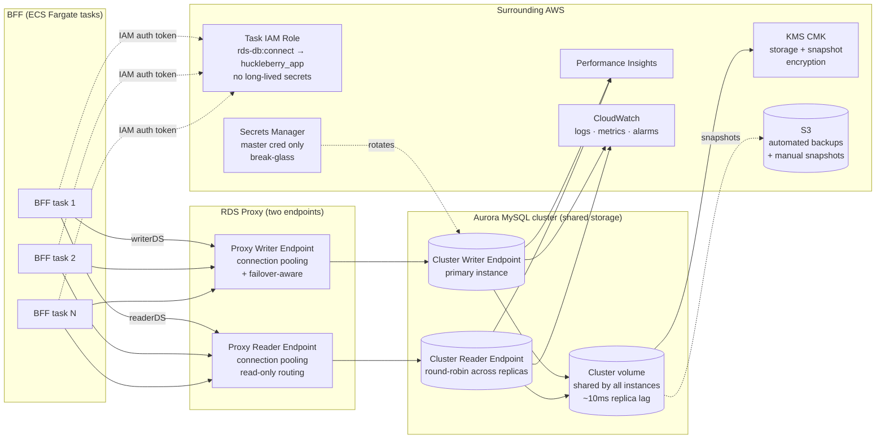
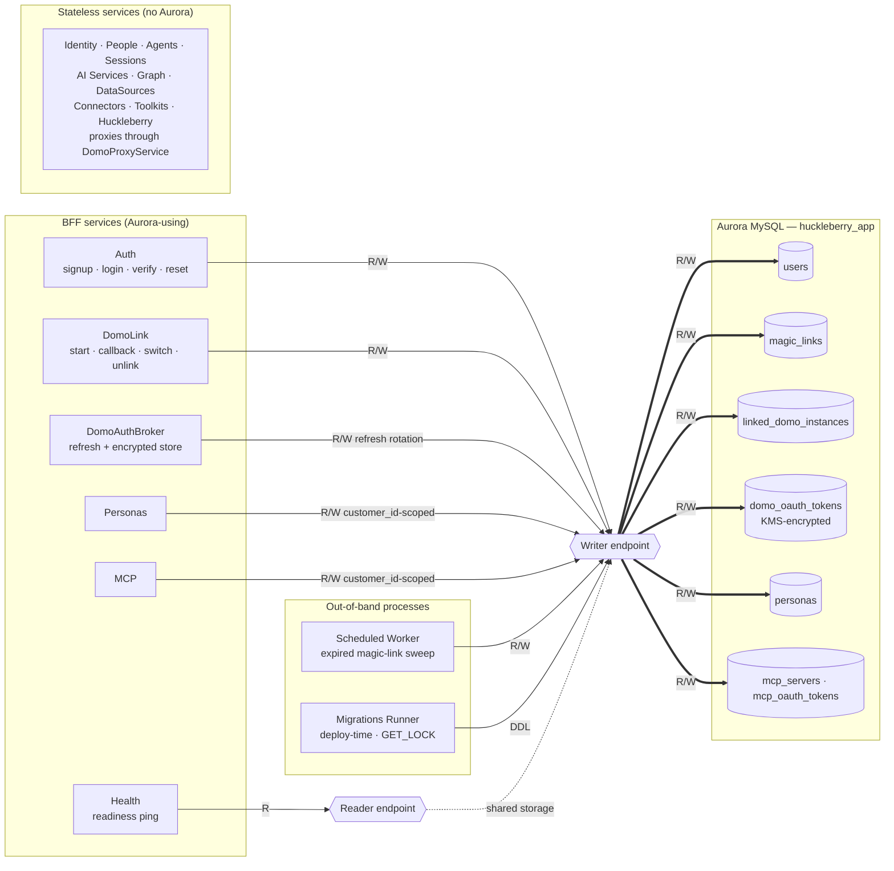
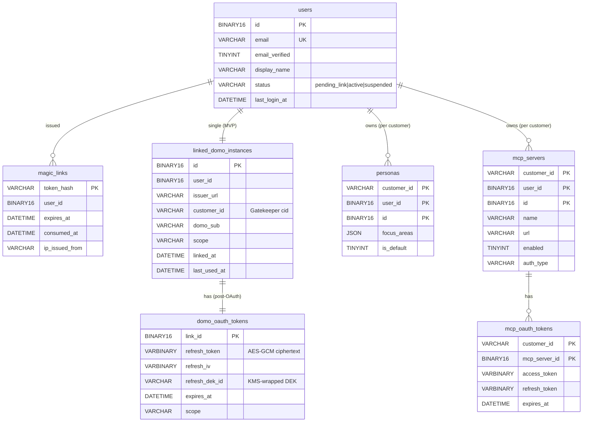

# Aurora MySQL Integration — MVP

How Huckleberry's BFF talks to Aurora, what AWS services surround the cluster, and which BFF services own which tables. Aurora MySQL chosen to match existing AWS infrastructure.

**MVP scope:** minimal auth schema (single user, single Domo instance, single identity). Tenancy, multi-instance, and multi-IdP tables are deferred — see "Deferred for post-MVP" in `auth-architecture.md`.

## Connectivity & infra

### Why each piece

| Component | Why it's there |
|---|---|
| **RDS Proxy (two endpoints)** | NestJS+mysql2 opens a connection per task. With autoscaled Fargate, raw connection counts spike past Aurora's limits during deploys. Proxy multiplexes. Configure **two proxy endpoints**: one for writer (default), one for reader (`READ_ONLY` target role). BFF holds two connection pools — `writerDS` and `readerDS` — pointed at each |
| **Cluster Writer endpoint** | DNS that always points at the current primary instance. Aurora repoints automatically on failover (~30s) — proxy hides the blip from app code |
| **Cluster Reader endpoint** | DNS that round-robins across all replica instances. Read-only. Low replica lag (~10ms) because all instances read from the same shared cluster volume |
| **Shared cluster volume** | Aurora's distinguishing feature — all instances (writer + readers) share one storage layer. Replicas don't replicate via redo log shipping; they just read pages from the same volume. Storage scales independently of compute |
| **Task IAM role + IAM database auth** | BFF connects to Aurora using a 15-minute auth token signed from the ECS task role's `rds-db:connect` permission. **No DB password exists** — not in env, not in Secrets Manager, not in the container. Revocation = remove the IAM statement. See `../authentication.md` § AWS service authentication |
| **Secrets Manager (break-glass only)** | Holds the Aurora master credential for one-off admin access. App tier never reads from it. App-cred rotation is not needed because there is no app password to rotate |
| **KMS CMK** | Storage-level encryption for the cluster volume + automated snapshots. Customer-managed key, not AWS-managed, so we control rotation and access |
| **Performance Insights** | Query-level telemetry. Surfaces slow queries before they page someone |
| **CloudWatch alarms** | CPU, connection count, replica lag, free storage, deadlock rate |

## Service → table ownership

Three table groups: huckleberry identity, Domo linkage, Category B app data. Category A controllers (Identity, People, Agents, Sessions, AI Services, Graph, DataSources, Connectors, Toolkits, Huckleberry) are stateless — they forward the user's *active linked* Domo Bearer through `DomoProxyService`.

### Per-service interaction summary

| Service | Tables touched | R/W | Endpoint | Notes |
|---|---|---|---|---|
| Auth (Layer A) | `users`, `magic_links` | R/W | writer | Magic-link only (no passwords). SES emails, rate-limited |
| DomoLink (Layer B) | `linked_domo_instances`, `domo_oauth_tokens` | R/W | writer | OAuth code exchange + KMS encrypt on insert |
| DomoAuthBroker (Layer B) | `domo_oauth_tokens` (rotation), `linked_domo_instances` (last_used_at) | R/W | writer | Single-use refresh rotation per OAuth 2.1 |
| Personas (Category B) | `personas` | R/W | writer | All rows `(customer_id, user_id)`-scoped |
| MCP (Category B) | `mcp_servers`, `mcp_oauth_tokens` | R/W | writer | Third-party MCP creds KMS-encrypted |
| Health | none (`SELECT 1`) | R | reader | Cheap probe |
| Worker | `magic_links` (expired sweep), `mcp_oauth_tokens` (expired sweep) | R/W | writer | Memory lives in Mako, not Aurora |
| Migrations | all | DDL | writer | Deploy-time; `GET_LOCK('hb_migrate', 30)`; separate DB user |
| Identity, People, Agents, Sessions, AI Services, Graph, DataSources, Connectors, Toolkits, Huckleberry | none | — | — | Stateless — forward Bearer from active link |

## Schema relationships (ER) — MVP

> **Deferred for post-MVP** (see `auth-architecture.md`): `tenants`, `instances`, `linked_identities`, `tenant_memberships`, `invitations`, `audit_log`. Add when a real feature requires them.

## Operational decisions worth being explicit about

| Decision | Choice | Why |
|---|---|---|
| Aurora flavor | Aurora MySQL (provisioned or Serverless v2) | Matches existing AWS infra; team already operates Aurora MySQL. Serverless v2 if traffic is bursty |
| MySQL version | 8.0+ | Required for `JSON` improvements, `BINARY(16)` UUID ergonomics, window functions |
| Connection layer | RDS Proxy mandatory | Fargate autoscale + per-task pools blow connection limits without it |
| Migrations | Versioned SQL via `drizzle-kit` or `umzug` | Run from BFF container at deploy time with `GET_LOCK('hb_migrate', 30)` |
| App-tier DB auth | **IAM database authentication** via the ECS task role | No password to rotate; 15-min token signed per connection. See `../authentication.md` § AWS service authentication |
| Secrets Manager scope | Master credential only (break-glass admin access) | App tier never reads it; no rotation impact on running pods |
| Backup | 35-day automated retention + weekly manual snapshot | Manual snapshot survives cluster delete; automated does not |
| Encryption | KMS CMK at rest + TLS in transit (`?ssl={"rejectUnauthorized":true}`) | Token columns also encrypted at column level via KMS envelope encryption — defense in depth |
| Read replicas | 1 reader minimum, autoscaled by CPU | Cheap insurance for failover + offload of audit/analytics reads |
| Database separation | Single `huckleberry_app` database | Category B + Layer A/B tables all share one database. Splitting comes later if a feature demands it. |
| Primary key type | `BINARY(16)` UUIDs via `UUID_TO_BIN(uuid, 1)` | Half the storage of `CHAR(36)`, index-friendly time-prefix ordering. Swap-flag (`1`) reorders timestamp bits for better B-tree locality |
| ORM | Drizzle (preferred) or TypeORM, MySQL driver | Both support MySQL natively |
| Multi-AZ | Required in prod | Single-AZ Aurora is not actually HA |
| Datasource split | Two datasources: `writerDS` (writer endpoint) and `readerDS` (reader endpoint) | Services declare intent; replica reads cut writer load |
| Migrations runner | Separate ECS task at deploy time, elevated DB role, `GET_LOCK('hb_migrate', 30)` | Prevents concurrent migration runs across simultaneous deploys |
| Background worker | ECS scheduled task or EventBridge → Lambda | Token cleanup, session sweep, invitation expiry, audit retention |
| Audit log | **Deferred** for MVP — CloudWatch logs cover internal-use compliance | Bring back as Aurora table when first SQL-join compliance query is needed |
| JSON columns | `JSON` type for `personas.focus_areas` etc. | MySQL `JSON` is functional but lacks PG `jsonb` performance. Add generated columns + indexes if querying inside JSON becomes hot |

## What's encrypted at the column level (not just at rest)

Two distinct sets of OAuth tokens live on the BFF, both KMS envelope-encrypted:

| Column | Why |
|---|---|
| `domo_oauth_tokens.refresh_token` | Per-link Domo refresh credential. Backup leaks shouldn't expose the user's ability to act against Domo. |
| `mcp_oauth_tokens.access_token` | Third-party MCP credentials. |
| `mcp_oauth_tokens.refresh_token` | Same. |

Mechanism: KMS-wrapped DEK stored alongside the ciphertext (`refresh_dek_id`), AES-GCM with a per-row IV. Plaintext DEK cached in-process for a short window — KMS is called only on cache miss. Backups are unreadable without KMS access.

There is no `users.password_hash` — magic-link only. `magic_links.token_hash` is SHA-256 (not encrypted; pre-image is the random token and only travels via SES email).

KMS envelope encryption: Huckleberry holds a data key (cached), KMS holds the wrapping key. Rotating the wrapping key re-encrypts data keys, not every row.
