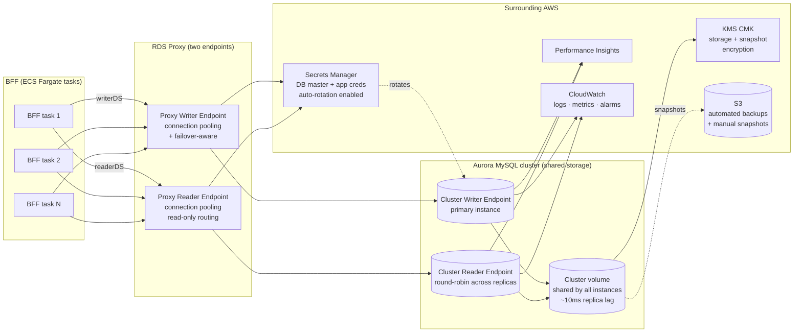
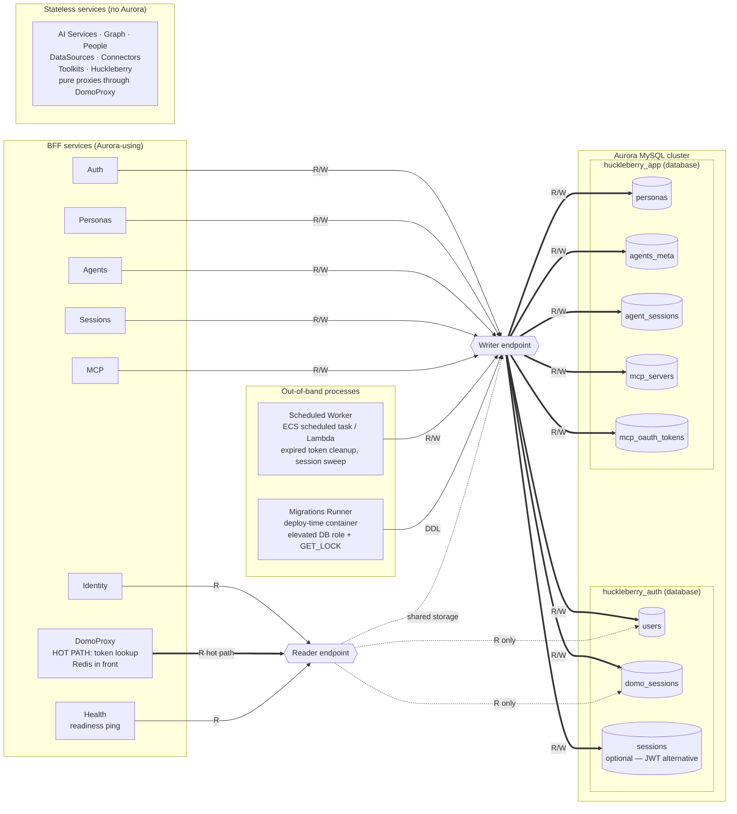

# Aurora MySQL Integration — MVP

How Huckleberry's BFF talks to Aurora, what AWS services surround the cluster, and which BFF services own which tables. Aurora MySQL chosen to match existing AWS infrastructure.

**MVP scope:** minimal auth schema (single user, single Domo instance, single identity). Tenancy, multi-instance, and multi-IdP tables are deferred — see "Deferred for post-MVP" in `auth-architecture.md`.

## Connectivity & infra



### Why each piece

| Component | Why it's there |
|---|---|
| **RDS Proxy (two endpoints)** | NestJS+mysql2 opens a connection per task. With autoscaled Fargate, raw connection counts spike past Aurora's limits during deploys. Proxy multiplexes. Configure **two proxy endpoints**: one for writer (default), one for reader (`READ_ONLY` target role). BFF holds two connection pools — `writerDS` and `readerDS` — pointed at each |
| **Cluster Writer endpoint** | DNS that always points at the current primary instance. Aurora repoints automatically on failover (~30s) — proxy hides the blip from app code |
| **Cluster Reader endpoint** | DNS that round-robins across all replica instances. Read-only. Low replica lag (~10ms) because all instances read from the same shared cluster volume |
| **Shared cluster volume** | Aurora's distinguishing feature — all instances (writer + readers) share one storage layer. Replicas don't replicate via redo log shipping; they just read pages from the same volume. Storage scales independently of compute |
| **Secrets Manager + rotation** | DB password rotates on a schedule; BFF reads creds at boot and on rotation event. Never hardcoded, never in env files |
| **KMS CMK** | Storage-level encryption for the cluster volume + automated snapshots. Customer-managed key, not AWS-managed, so we control rotation and access |
| **Performance Insights** | Query-level telemetry. Surfaces slow queries before they page someone |
| **CloudWatch alarms** | CPU, connection count, replica lag, free storage, deadlock rate |

## Service → table ownership



### Per-service interaction summary

| Service | Tables touched | R/W | Endpoint | Notes |
|---|---|---|---|---|
| Auth | `users`, `domo_sessions`, `sessions` | R/W | writer | Owns `huckleberry_auth` database |
| Identity | `users` | R only | reader | Profile lookup; tolerates replica lag |
| Personas | `personas` | R/W | writer | |
| Agents | `agents_meta` | R/W | writer | Local cache; truth in Domo |
| Sessions | `agent_sessions` | R/W | writer | Local index; events from Domo |
| MCP | `mcp_servers`, `mcp_oauth_tokens` | R/W | writer | |
| DomoProxy | `domo_sessions` | **R hot path** | reader | Redis-cached; Aurora is fallback only |
| Health | any | R | reader | Cheap probe (`SELECT 1`) |
| Worker | `domo_sessions`, `sessions` | R/W | writer | Expired token + session cleanup |
| Migrations | all | DDL | writer | Deploy-time only; `GET_LOCK('hb_migrate', 30)` |
| AI / Graph / People / DataSources / Connectors / Toolkits / Huckleberry | none | — | — | Stateless proxies |

## Schema relationships (ER) — MVP

```mermaid
erDiagram
    users ||--|| domo_sessions : "has"
    users ||--o{ sessions : "owns"
    users ||--o{ personas : "owns"
    users ||--o{ agents_meta : "owns"
    users ||--o{ agent_sessions : "owns"
    users ||--o{ mcp_servers : "registers"
    mcp_servers ||--o{ mcp_oauth_tokens : "has"

    users {
        BINARY16 id PK
        VARCHAR domo_user_id
        VARCHAR domo_instance
        VARCHAR email
        VARCHAR display_name
        DATETIME last_login_at
    }
    domo_sessions {
        BINARY16 user_id PK_FK
        VARBINARY access_token
        VARBINARY refresh_token "NULL under domoweb"
        DATETIME expires_at
    }
    sessions {
        BINARY16 id PK
        BINARY16 user_id FK
        DATETIME expires_at
        VARCHAR ip
        VARCHAR user_agent
    }
    personas { BINARY16 id PK, BINARY16 user_id FK, JSON focus_areas }
    agents_meta { BINARY16 id PK, VARCHAR domo_agent_id, BINARY16 user_id FK }
    agent_sessions { BINARY16 id PK, BINARY16 user_id FK, VARCHAR domo_session_id }
    mcp_servers { BINARY16 id PK, BINARY16 user_id FK, VARCHAR url }
    mcp_oauth_tokens { BINARY16 mcp_server_id PK_FK, VARBINARY access_token, DATETIME expires_at }
```

> **Deferred for post-MVP** (see `auth-architecture.md`): `tenants`, `instances`, `linked_identities`, `tenant_memberships`, `invitations`, `audit_log`. Add when a real feature requires them.

## Operational decisions worth being explicit about

| Decision | Choice | Why |
|---|---|---|
| Aurora flavor | Aurora MySQL (provisioned or Serverless v2) | Matches existing AWS infra; team already operates Aurora MySQL. Serverless v2 if traffic is bursty |
| MySQL version | 8.0+ | Required for `JSON` improvements, `BINARY(16)` UUID ergonomics, window functions |
| Connection layer | RDS Proxy mandatory | Fargate autoscale + per-task pools blow connection limits without it |
| Migrations | Versioned SQL via `drizzle-kit` or `umzug` | Run from BFF container at deploy time with `GET_LOCK('hb_migrate', 30)` |
| Secrets | Secrets Manager + 30-day rotation | Lambda rotation function ships with RDS Proxy integration |
| Backup | 35-day automated retention + weekly manual snapshot | Manual snapshot survives cluster delete; automated does not |
| Encryption | KMS CMK at rest + TLS in transit (`?ssl={"rejectUnauthorized":true}`) | Token columns also encrypted at column level via KMS envelope encryption — defense in depth |
| Read replicas | 1 reader minimum, autoscaled by CPU | Cheap insurance for failover + offload of audit/analytics reads |
| Database separation | `huckleberry_auth` and `huckleberry_app` databases in same cluster | MySQL conflates schema and database, so two databases replace what would be two PG schemas. Same cluster, separate connection URLs |
| Primary key type | `BINARY(16)` UUIDs via `UUID_TO_BIN(uuid, 1)` | Half the storage of `CHAR(36)`, index-friendly time-prefix ordering. Swap-flag (`1`) reorders timestamp bits for better B-tree locality |
| ORM | Drizzle (preferred) or TypeORM, MySQL driver | Both support MySQL natively |
| Multi-AZ | Required in prod | Single-AZ Aurora is not actually HA |
| Datasource split | Two datasources: `writerDS` (writer endpoint) and `readerDS` (reader endpoint) | Services declare intent; replica reads cut writer load |
| Migrations runner | Separate ECS task at deploy time, elevated DB role, `GET_LOCK('hb_migrate', 30)` | Prevents concurrent migration runs across simultaneous deploys |
| Background worker | ECS scheduled task or EventBridge → Lambda | Token cleanup, session sweep, invitation expiry, audit retention |
| Audit log | **Deferred** for MVP — CloudWatch logs cover internal-use compliance | Bring back as Aurora table when first SQL-join compliance query is needed |
| JSON columns | `JSON` type for `personas.focus_areas` etc. | MySQL `JSON` is functional but lacks PG `jsonb` performance. Add generated columns + indexes if querying inside JSON becomes hot |

## What's encrypted at the column level (not just at rest)

| Column | Why |
|---|---|
| `oauth_tokens.access_token` | If a backup leaks, raw Domo tokens shouldn't |
| `oauth_tokens.refresh_token` | Same |
| `mcp_oauth_tokens.access_token` | Same logic for third-party MCP creds |

KMS envelope encryption: Huckleberry holds a data key (cached), KMS holds the wrapping key. Rotating the wrapping key re-encrypts data keys, not every row.
