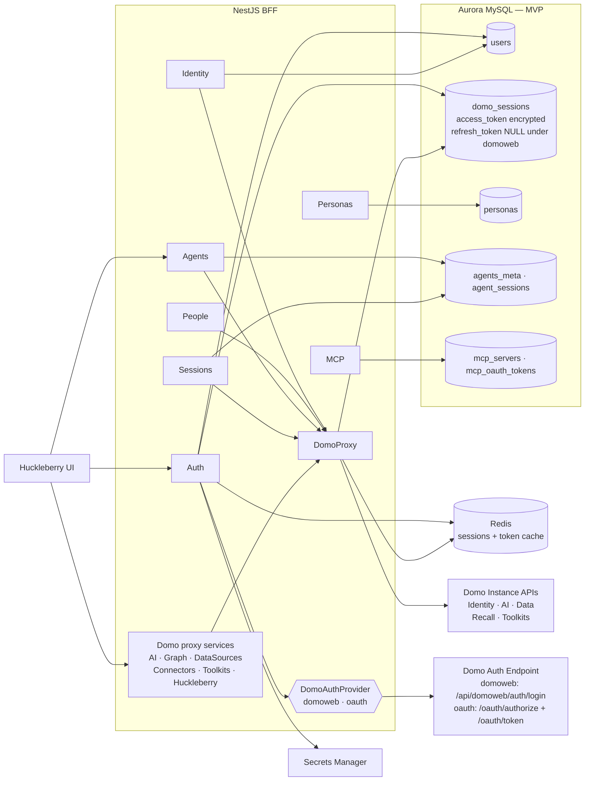

# Auth & Data Architecture — MVP (Internal Use)

Minimal schema for the v1 auth model: one user, one Domo instance, one identity. Multi-tenancy, multi-instance per user, and multi-IdP are deferred until we have a shared understanding of the post-MVP product.

The `DomoAuthProvider` block is the **swappable seam** — `domoweb` today (`/api/domoweb/auth/login`, plaintext creds), `oauth` once Domo ships authorization-code on instance APIs. See `auth-providers.md` for the interface and `domoweb-auth-flow.md` / `oauth-flow-future.md` for the per-provider flows.

Stateless proxy services (AI, Graph, DataSources, Connectors, Toolkits, Huckleberry) are collapsed into a single "Domo proxy services" node — they hold no local state and exist only to forward through DomoProxy.

Aurora is drawn as a single block at this abstraction level. Writer/reader endpoints, RDS Proxy, KMS, backups, worker, and migrations runner are detailed in `aurora-integration.md`.

## Diagram



## MVP Schema

```
users
  id              BINARY(16) PK
  domo_user_id    VARCHAR(64)
  domo_instance   VARCHAR(255)
  email           VARCHAR(255)
  display_name    VARCHAR(255)
  created_at, updated_at, last_login_at

domo_sessions       (1:1 with users)
  user_id         BINARY(16) PK FK → users
  access_token    VARBINARY        -- KMS envelope encrypted
  refresh_token   VARBINARY NULL   -- NULL under domoweb provider
  expires_at      DATETIME
  updated_at

(optional) sessions   -- only if using server-side sessions; skip if stateless JWT
  id              BINARY(16) PK
  user_id         BINARY(16) FK → users
  expires_at      DATETIME
  ip, user_agent
```

Plus the non-auth domain tables that already exist: `personas`, `agents_meta`, `agent_sessions`, `mcp_servers`, `mcp_oauth_tokens`. Those aren't part of "OAuth user management."

## Service ↔ Table matrix (MVP)

| Service | Tables |
|---|---|
| Auth | `users`, `domo_sessions`, `sessions` (if server-side) |
| Identity | `users` |
| People | none today (Domo-backed list) |
| Personas | `personas` |
| Agents / Sessions | `agents_meta`, `agent_sessions` |
| MCP | `mcp_servers`, `mcp_oauth_tokens` |
| Domo proxy services | none (stateless) |
| DomoProxy | reads `domo_sessions` (Redis-cached) |

## Deferred for post-MVP

These were in earlier designs and have been removed for now. Each comes back when a real feature requires it.

| Table / concept | Defer until |
|---|---|
| `tenants` | First customer wants multiple users sharing context |
| `instances` (separate from users) | A user actually needs to link a second Domo instance |
| `linked_identities` | Non-Domo SSO arrives, or one human needs multiple Domo accounts |
| `tenant_memberships` | Tenants exist |
| `invitations` | First "invite a teammate" feature |
| `audit_log` | First compliance / "who changed this?" ask |

## Migration path when we expand

When tenancy lands, the migration is mechanical, not painful:

1. Create `tenants`, `tenant_memberships`, `invitations`
2. Backfill one `tenants` row per existing user (each user becomes their own solo tenant)
3. Add `tenant_id` FK to `users`
4. (If multi-IdP) introduce `linked_identities`, move `domo_user_id` + `domo_instance` off `users` onto a new identity row, repoint `domo_sessions` FK

Column names are kept honest in v1 (e.g. `domo_user_id`, not `external_id`) so the future migration is a straightforward rename + foreign-key shift, not a data model rethink.
