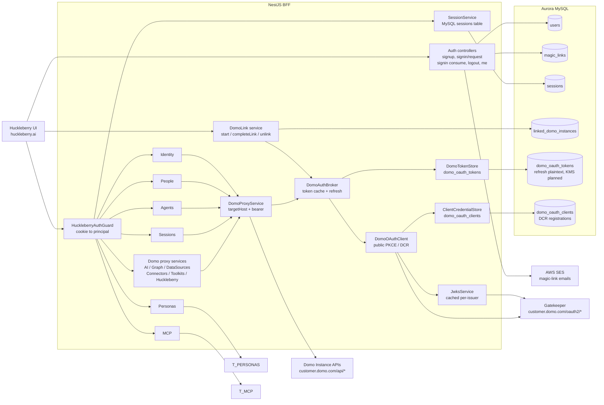

# Auth & Data Architecture — MVP

Where auth state lives. **Standalone huckleberry.ai with native identity + BFF-as-public-PKCE-OAuth-client to Domo.** Both layers are stored.

- **Layer A (huckleberry identity):** `users`, `magic_links`, `sessions` (MySQL).
- **Layer B (Domo linkage):** `linked_domo_instances`, `domo_oauth_tokens` (refresh tokens — plaintext now, KMS planned), `domo_oauth_clients` (DCR registrations).
- **Category B (app data):** `personas`, `mcp_servers`, `mcp_oauth_tokens` — designed, not yet in schema.

See `../authentication.md` for design rationale; `oauth-flow.md` for sequences.

## Diagram

## Aurora schema — MVP

Three layers of tables: identity, Domo linkage, app data. All carry `customer_id` where multi-tenancy applies; user-level tables carry the huckleberry `user_id`.

The canonical schema is defined in `src/common/db/schema.ts` (Drizzle ORM) with migrations in `drizzle/*.sql`. See those files for column types, indexes, and constraints.

- **Layer A (identity):** `users`, `magic_links`, `sessions`
- **Layer B (Domo linkage):** `linked_domo_instances`, `domo_oauth_tokens`, `domo_oauth_clients` (DCR registrations, migration 0002)
- **Category B (app data):** `personas`, `mcp_servers`, `mcp_oauth_tokens` — designed, not yet in schema

## Service ↔ Table matrix

| Service | Tables | R/W |
|---|---|---|
| Auth (Layer A) | `users`, `magic_links` | R/W |
| Sessions (Layer A) | `sessions` (in-memory store in dev) | R/W |
| SignupService | `users`, `linked_domo_instances` | R/W |
| DomoLinkService (Layer B) | `linked_domo_instances`, `domo_oauth_tokens` | R/W |
| DomoAuthBroker (Layer B) | `domo_oauth_tokens` (refresh rotation), `linked_domo_instances` (last_used_at) | R/W |
| ClientCredentialStore | `domo_oauth_clients` | R/W |
| Agents, AI Services, Toolkits, etc. | none (pure proxy) | — |

## Multi-tenant scoping

- `users.id` is **huckleberry-global**. A huckleberry user is not bound to any single Domo customer.
- `linked_domo_instances` is **one per user** (MVP). Multi-link is post-MVP.
- The active link (held in the session) determines which `customer_id` a request scopes to.

## What's encrypted at the column level

| Column | Status |
|---|---|
| `domo_oauth_tokens.refresh_token` | **Plaintext now.** KMS envelope encryption planned before external launch. |

No password hashes are stored (magic-link only). `magic_links.token_hash` is SHA-256 of the random token; the token itself never lands in the DB.
