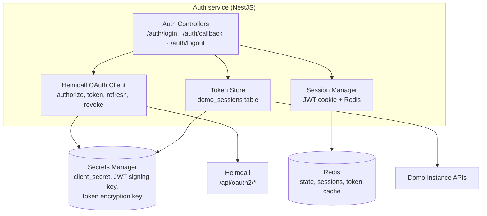

# Auth Service — Heimdall OAuth (single provider)

> **Note:** earlier drafts of this document defined a `DomoAuthProvider` interface with two implementations (`DomoWebAuthProvider`, `DomoOAuthProvider`) so today's plaintext-credential path could be swapped for OAuth later. **That seam is no longer needed.** Heimdall (Domo's internal OAuth2 server, `~/dev/heimdall`) supports authorization-code flow with confidential clients today. Huckleberry registers as `domo:internal:huckleberry` and uses Heimdall directly.
>
> The retired `domoweb-auth-flow.md` is kept only as historical context.

## Auth service shape

Single OAuth2 client implementation against Heimdall. No abstraction over alternate providers — there's only one.



## Module surface

```ts
// src/auth/heimdall-oauth.client.ts
class HeimdallOAuthClient {
  buildAuthorizeUrl(params: { state: string; codeChallenge: string; scope: string }): string;
  exchangeCode(params: { code: string; codeVerifier: string }): Promise<TokenResponse>;
  refresh(params: { refreshToken: string }): Promise<TokenResponse>;
  revoke(params: { token: string; tokenTypeHint: 'access_token' | 'refresh_token' }): Promise<void>;
}

interface TokenResponse {
  accessToken: string;       // RS256 JWT, 1h TTL
  refreshToken: string;      // 2y TTL, no rotation — same underlying ID
  expiresAt: Date;
  scope: string;
  // decoded from JWT for convenience
  domoUserId: string;        // sub claim
  customerId: string;        // cid claim
  instanceId: string;        // iid claim
}
```

`HeimdallOAuthClient` is the only OAuth implementation. No interface, no factory, no env-flag selection.

## Heimdall registration (as proposed)

| Field | Value |
|---|---|
| `ID` | `domo:internal:huckleberry` |
| `Secret` | UUID issued by Heimdall, stored in AWS Secrets Manager |
| `Name` | `Huckleberry` |
| `Internal` | `true` |
| `Confidential` | `true` |
| `RequireStopScreens` | `true` |
| `RedirectURIs` | `http://localhost:3000/auth/callback`, staging URL, prod URL |

Registration mechanism today: PR to Heimdall's `oauth2/client.go` `preApprovedClients` list. (Heimdall has a code TODO to make this dynamic; we'll switch when that lands.)

## Scopes requested

`ai-services content data user-profile` — covers `/api/ai/v1/*`, `/api/recall/v1/*`, `/api/content/v3/*`, `/api/data/v3/*`, and `/users/me`. Avoid `user` and `identity` until we have a feature that mutates users.

## Token lifecycle

| Event | Behavior |
|---|---|
| Login completes | Store access_token + refresh_token encrypted in `domo_sessions`, cache access_token in Redis |
| Request comes in | Validate hb_session cookie, look up access_token (Redis hot-path, DB fallback) |
| Access token within 1h TTL | Use it directly as `Authorization: Bearer ...` against instance APIs |
| Access token expired | Call Heimdall `/token` with `grant_type=refresh_token`, persist new access_token, refresh_token value stays the same |
| User logs out | Call Heimdall `/api/oauth2/revoke` for refresh_token, clear `domo_sessions` row, drop hb_session |
| Refresh token after 2y | User re-logs in (re-auth via `/api/oauth2/authorize`) |

## What was retired from the earlier design

- `DomoAuthProvider` interface — single implementation, no abstraction needed
- `DomoWebAuthProvider` (plaintext password flow) — Heimdall removes the need
- `linked_identities.provider` discriminator column — only one provider exists; collapsed onto `users` directly
- `oauth_tokens` table renamed to `domo_sessions` to be specific about what it holds
- Per-instance `client_id` / `client_secret` — Huckleberry has one Heimdall registration, period

## Code-level rules (build now, OAuth 2.1 cheap insurance)

These are the "cheap insurance" items from `oauth-flow.md` expressed as code-level requirements. Apply them on the first pass — retrofitting is expensive, getting them right at the start is free.

### Required behaviors

1. **Always overwrite `domo_sessions.refresh_token` from the refresh response.** Heimdall reuses the value today; we treat every refresh response as authoritative. When rotation lands, no code change.

   ```ts
   // in HeimdallOAuthClient.refresh()
   await tokenStore.update(userId, {
     accessToken: resp.access_token,
     refreshToken: resp.refresh_token,  // overwrite even if unchanged
     expiresAt: new Date(Date.now() + resp.expires_in * 1000),
     scope: resp.scope,
   });
   ```

2. **Verify RS256 JWT signature before trusting claims.** Fetch Heimdall JWKS at boot, cache, verify on every decode. Never trust `jwt.decode()` output without verification.

   ```ts
   // src/auth/jwt-verifier.ts
   export async function verifyAndDecodeAccessToken(jwt: string): Promise<AccessTokenClaims> {
     const { payload } = await jose.jwtVerify(jwt, jwksRemote, {
       issuer: HEIMDALL_ISSUER,
       audience: HUCKLEBERRY_CLIENT_ID,
     });
     return payload as AccessTokenClaims;
   }
   ```

   This is the **only** path JWT claims are read. No ad-hoc `jwt.decode` anywhere else.

3. **Validate `iss` and `aud` claims** as part of #2 (above). The `jose.jwtVerify` options enforce both. If either fails, throw — don't silently accept.

4. **On refresh failure (401 or `invalid_grant`), kill the Huckleberry session.**

   ```ts
   try {
     await heimdall.refresh({ refreshToken: stored.refreshToken });
   } catch (err) {
     if (err instanceof HeimdallAuthError) {
       await sessionStore.invalidate(userId);
       await tokenStore.delete(userId);
       throw new UnauthorizedException('Heimdall session ended, re-login required');
     }
     throw err;
   }
   ```

   Closes the window where a revoked Heimdall token leaves a working `hb_session`.

5. **Single bearer-injection point in DomoProxy.** All outbound Domo calls go through one function that adds `Authorization: Bearer <token>`. When DPoP support is added, this is the only place that grows a second header.

   ```ts
   // src/domo-proxy/inject-bearer.ts
   export function injectBearer(req: AxiosRequestConfig, accessToken: string) {
     req.headers = { ...req.headers, Authorization: `Bearer ${accessToken}` };
     // future: DPoP header injection lives here
     return req;
   }
   ```

6. **Reject `?access_token=` query parameters.** No controller accepts bearer tokens via URL. NestJS `AuthGuard` reads `Authorization` header only — keep it that way.

7. **Persist `scope` on `domo_sessions`.** Already in schema. On request, if the scope needed for an endpoint isn't in the stored grant, force re-auth rather than silently failing later.

8. **Exact redirect URI on our callback.** Don't loosen routing to accept variants of `/auth/callback` — single exact path, no path params, no trailing-slash tolerance.

### Forbidden patterns

- `jwt.decode()` without verification (use `verifyAndDecodeAccessToken`)
- Reading `Authorization` header in any service other than auth + DomoProxy
- Storing access_token or refresh_token in plaintext anywhere — including logs
- Logging the full JWT — log `jti` claim or first 8 chars only
- Catching Heimdall errors generically and continuing — auth failures must propagate

### What we are NOT building now (deferred — see `oauth-flow.md` table A–H)

DPoP, front/back-channel logout, periodic introspection, multi-device sessions, discovery doc fetch, mTLS client auth, refresh-token hashing, inbound bearer introspection. Each has a defined trigger to revisit.
