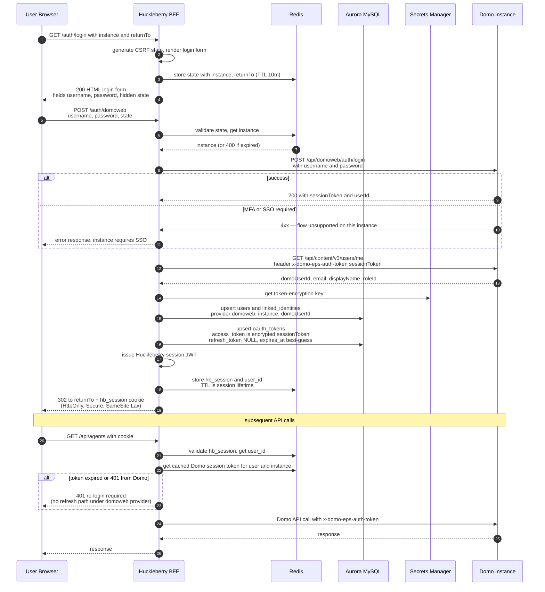

# Domo Web Auth Flow — RETIRED

> **🪦 Retired.** This flow was a fallback for when we thought Domo had no user-facing OAuth. Confirmed against `~/dev/heimdall` that Heimdall supports authorization-code OAuth with confidential clients today, so Huckleberry uses that instead. See `oauth-flow.md`.
>
> Kept only as historical context for the design decision. Do not implement.

---

What we *would* have built first if Heimdall were not available. Uses Domo's internal `/api/domoweb/auth/login` endpoint, which accepts plaintext username + password and returns an instance session token usable against `/api/ai/v1/*`, `/api/recall/v1/*`, etc.

> **Caveats** (see fuller discussion in conversation history):
> - This is the OAuth 2.0 ROPC anti-pattern: Huckleberry holds plaintext credentials in flight
> - Breaks for SSO-only / MFA-enforced instances
> - `/api/domoweb/auth/*` is undocumented and may change without notice
> - Acceptable for dev / internal Domo-employee use; not for external customers
> - Designed to be swapped out via the `DomoAuthProvider` seam — see `auth-providers.md`

## Sequence

## What's different from the OAuth future state

| Aspect | Today (domoweb) | Future (OAuth 2.1) |
|---|---|---|
| User enters credentials on | Huckleberry-hosted form | Domo-hosted login page |
| Huckleberry sees password? | Yes (plaintext in flight) | No |
| MFA / SSO supported? | No | Yes |
| Refresh token? | No — re-login on expiry | Yes — silent refresh |
| Domo endpoint | `/api/domoweb/auth/login` | `/oauth/authorize` + `/oauth/token` |
| `linked_identities.provider` | `domoweb` | `domo_oauth` |
| `oauth_tokens.refresh_token` | NULL | populated |
| CSRF mechanism | hidden form field | `state` param on callback |
| Bearer header | `x-domo-eps-auth-token` | `Authorization: Bearer ...` |

## Operational notes

- **Session token lifetime is opaque.** Domo doesn't return `expires_in`. Treat any 401 as expiry → force re-login. Optionally probe with a cheap call (e.g. `/users/me`) on a timer to detect expiry early.
- **Never log the password.** Scrub `password` from request bodies in any access log / error reporter middleware before this controller is enabled.
- **Rate-limit `POST /auth/domoweb` aggressively.** Otherwise Huckleberry becomes a credential-stuffing oracle against Domo.
- **Feature-flag the controller.** `AUTH_PROVIDER=domoweb` enables it; production deploys default to a safer provider once available.
