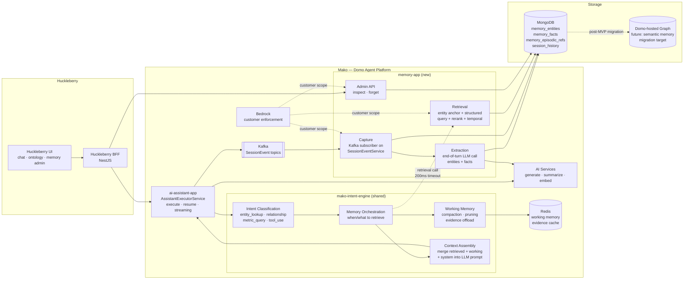
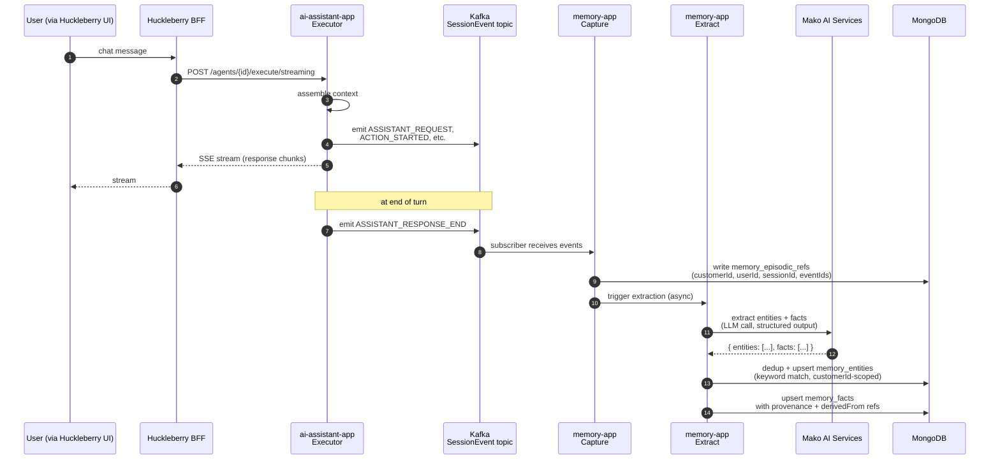
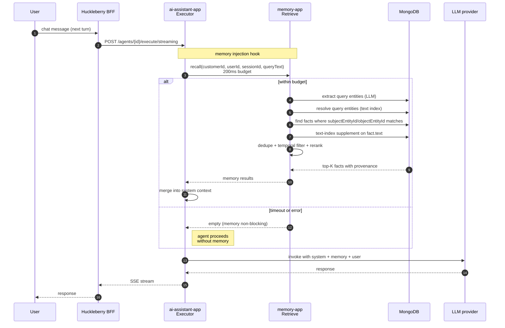

# Memory Architecture — MVP

Multi-tier memory built into Mako (Domo agent platform), **centered on the intent engine**. Huckleberry consumes implicitly through the agent runtime; explicit access only for admin UI and eval. Designed so any Domo agent — not just Huckleberry — can use it.

**At MVP:** MongoDB-backed, no vector search yet, retrieval is keyword + structured queries. Schema is graph-migration-friendly so post-MVP unlocks (vector search, graph backend) are mechanical.

## The Intent Engine

The **intent engine** is the runtime layer that manages context and intent for the agent. Everything else in this architecture serves it. Per the memory design doc: *"This layer is primarily focused on context and intent engineering"* — it sits on top of message history and session events, decides what's relevant for the current turn, calls into durable memory when needed, and shapes the prompt the LLM finally sees.

Concretely the intent engine is responsible for:

1. **Intent classification** — what is the user actually asking? (`entity_lookup | relationship | metric_query | tool_use | other`)
2. **Working memory management** — message-history compaction, pruning, evidence offload, active goal/plan/checklist tracking
3. **Memory orchestration** — deciding when and what to retrieve from durable memory tiers (episodic, semantic, procedural)
4. **Context assembly** — merging retrieved memory + working state + agent system prompt into the final LLM context

It is the **brain** that turns raw input into focused, high-signal context. Memory tiers (episodic, semantic, procedural) are the *substrate*; the intent engine is the *operator*.

In Mako, the intent engine ships as the **`mako-intent-engine`** shared module. Working memory is one capability of the intent engine, not the whole thing. Used by `ai-assistant-app`; productized for any future Mako agent.

## Tiers

| Tier | What it holds | Where it lives at MVP | Module |
|---|---|---|---|
| **Intent engine (runtime / working memory)** | Active task state, intent classification, working memory compaction, memory-call orchestration, context assembly | In-process per execution (Redis for evidence offload) | `mako-intent-engine` (shared library) |
| **Episodic memory** | Chronological session events — what the agent did and saw | MongoDB session-history collections (existing) + `memory_episodic_refs` | `memory-app` + existing `ai-app` |
| **Semantic memory** | Entities and facts learned from interactions | MongoDB (`memory_entities`, `memory_facts`) | `memory-app` |
| **Procedural memory** | Learned execution patterns | Stub at MVP; full integration with Domo Recall is post-MVP | `memory-app` (interface only) |

## Component diagram



## Data flow — capture and extraction



## Data flow — retrieval injection



## Provenance — every memory write carries

```ts
type Provenance = {
  source: 'agent' | 'session' | 'document' | 'human' | 'system';
  customerId: string;          // MANDATORY — Bedrock enforcement
  userId: string;
  sessionId?: string;
  scope: 'user' | 'instance' | 'org';
  confidence: number;          // 0..1
  createdAt: string;           // ISO 8601
  validStartingAt?: string;    // bi-temporal — defaults to createdAt at MVP
  invalidAt?: string | null;
  expiredAt?: string | null;
  derivedFromCount?: number;   // populated post-MVP for community ranking
  derivedFrom?: string[];      // MongoDB session event IDs
};
```

Every entity, fact, and episodic reference carries this metadata. Schema accommodates post-MVP features (decay, supersession, community detection) without migration.

## Mongo schema (graph-migration-friendly)

| Collection | Purpose | Equivalent in graph (post-MVP) |
|---|---|---|
| `memory_entities` | One doc per entity. `{_id, customerId, name, type, summary, embedding (null at MVP), provenance}` | `(:Entity)` nodes |
| `memory_facts` | One doc per atomic fact. `{_id, customerId, subjectEntityId, predicate, objectEntityId?, text, embedding (null at MVP), confidence, provenance}` | Typed relationships with properties |
| `memory_episodic_refs` | References from facts/entities to originating session events. `{_id, customerId, memoryId, sessionEventId, sessionId, createdAt}` | `[:DERIVED_FROM]` edges |

**Indexes (MVP):**
- Compound `(customerId, name)` and `(customerId, type)` on `memory_entities`
- Compound `(customerId, subjectEntityId)`, `(customerId, objectEntityId)` on `memory_facts`
- Mongo text indexes on `memory_entities.name + summary` and `memory_facts.text` for keyword retrieval
- Compound `(customerId, sessionId)` on `memory_episodic_refs`
- **No vector indexes** at MVP. Embedding fields reserved on documents but unpopulated.

## What's IN at MVP

- **Intent engine (`mako-intent-engine`)** — shared module; intent classification (basic), working memory compaction/pruning, memory-call orchestration, context assembly
- Episodic capture from agent turns → MongoDB
- Entity + fact extraction (B+: entities + facts, preferences as stretch)
- Retrieval call from intent engine before LLM invocation (200ms budget; non-blocking)
- Bedrock customer-scoped enforcement on every operation
- Right-to-forget admin API: cascades `memory_entities`, `memory_facts`, `memory_episodic_refs`
- Provenance metadata fully wired

## What's OUT (post-MVP, planned with shape ready)

- **Vector search / semantic similarity** — adds when Mako has Atlas Vector Search or migrates to a graph with native vector index. Embedding fields already reserved.
- **Graph migration** — Mongo docs map mechanically to graph nodes/edges. Schema designed for it.
- **Procedural memory** — interface stub at MVP; full Domo Recall integration post-MVP.
- **Promotion mechanics** — candidate → canonical with validation pipeline. MVP writes go canonical directly.
- **Decay strategy / `expired_at` workflows** — fields exist, not exercised.
- **Community detection (Leiden), hierarchical summarization** — post-MVP organizational layer.
- **Document/file ingestion** — separate ingestion path with chunk hierarchy.
- **Reflection step** in extraction — single-pass extraction at MVP.
- **Truth resolution / supersession** of competing assertions — fields modeled, resolver deferred.
- **Bi-temporal queries** — `validStartingAt` defaults to `createdAt` at MVP.

## Cross-cutting properties

- **Memory never blocks the agent.** 200ms timeout on retrieval; failure proceeds without memory. Logged + alerted.
- **Customer isolation is non-negotiable.** Every operation carries `customerId`; Bedrock enforces. Cross-customer leakage = MVP fail.
- **Productized for Domo platform.** Both `mako-intent-engine` and `memory-app` are shared infrastructure; any Mako agent can consume them, not just Huckleberry.
- **One hook in agent runtime.** `AssistantExecutorService` invokes the intent engine; the intent engine orchestrates everything else (working memory, retrieval, context assembly). The executor sees one entry point, not four.

## Open questions to resolve before May 1

1. Intent engine module name (`mako-intent-engine` proposed; confirm naming convention with platform team)
2. Right-to-forget granularity — `(customerId, userId)` or `(customerId, userId, sessionId)`?
3. Extraction LLM choice — which Mako AI service / model? Cost + latency budget?
4. Mongo cluster — confirm existing Mongo cluster Mako uses can host new memory collections, or needs dedicated provisioning
5. Procedural memory stub interface shape (so post-MVP Recall integration is clean)
6. Preferences (stretch goal) trigger — what signal during development tells us to layer them in?

## References

- Multi-layered memory design doc (internal — working / episodic / semantic / procedural / promotion / lifecycle)
- 3-month MVP roadmap: `../huckleberry-3-month-mvp-plan.md`
- Mako repo: `~/dev/mako`
