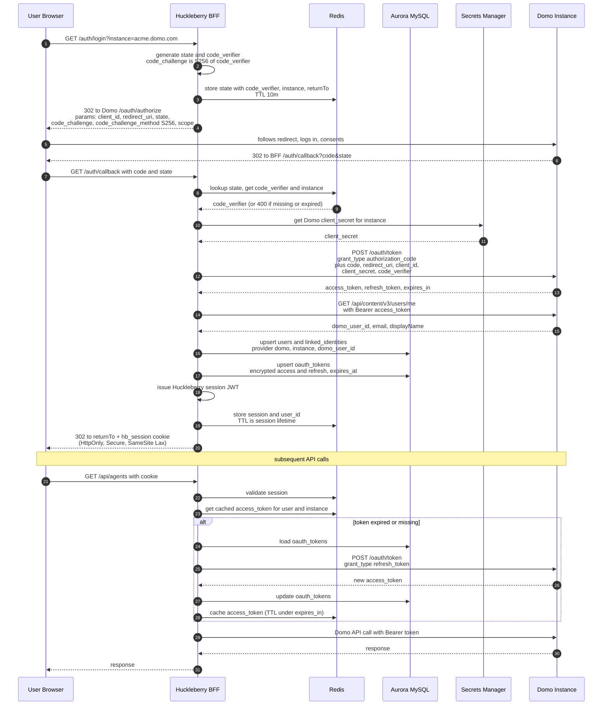

# Domo OAuth Flow — FUTURE STATE (Authorization Code + PKCE)

> **⚠️ Not buildable today.** Domo's public OAuth (`api.domo.com/oauth/token`, per `DomoApps/domo-documentation-hub/openapi/platform/authentication.yaml`) currently supports **only `grant_type=client_credentials`** — no `/oauth/authorize` endpoint, no authorization-code flow, no PKCE. The instance APIs Huckleberry depends on (`/api/ai/v1/*`, `/api/recall/v1/*`) are not on that surface either.
>
> This document describes the **target state** for when Domo ships authorization-code OAuth on instance APIs. For what we build now, see `domoweb-auth-flow.md`. For how the auth service abstracts over both, see `auth-providers.md`.

Server-side authorization code flow. Huckleberry's NestJS backend is a **confidential client** — `client_secret` lives in Secrets Manager and never leaves the server. PKCE is layered on as defense-in-depth (binds the code to the originating session so a stolen code can't be redeemed).

## Sequence

## Why this flow

- **Authorization code, not implicit / not PKCE-only** — backend keeps `client_secret`, tokens never touch the browser
- **PKCE on top** — protects against authorization-code interception even with a confidential client (current OAuth 2.1 guidance)
- **`state` parameter** — CSRF protection on the callback; also doubles as the lookup key for the per-flow `code_verifier` and the originating instance
- **Tokens encrypted at rest** — KMS-backed envelope encryption on `oauth_tokens.access_token` / `refresh_token`
- **Redis as token cache** — avoids a DB read on every Domo API call; falls back to DB on miss
- **Per-instance client credentials** — `client_id` / `client_secret` keyed by Domo instance in Secrets Manager, since each instance registers Huckleberry separately

## Open questions

1. Does Domo support PKCE (`code_challenge_method=S256`)? If only plain auth code, drop steps and accept slightly weaker code-interception protection.
2. What scopes does Domo expose? Need least-privilege scope list before going live.
3. Refresh token lifetime and rotation behavior — does Domo issue a new refresh token on refresh, or reuse?
4. Redirect URI registration — one per environment (`localhost`, staging, prod) per instance, or wildcard support?
