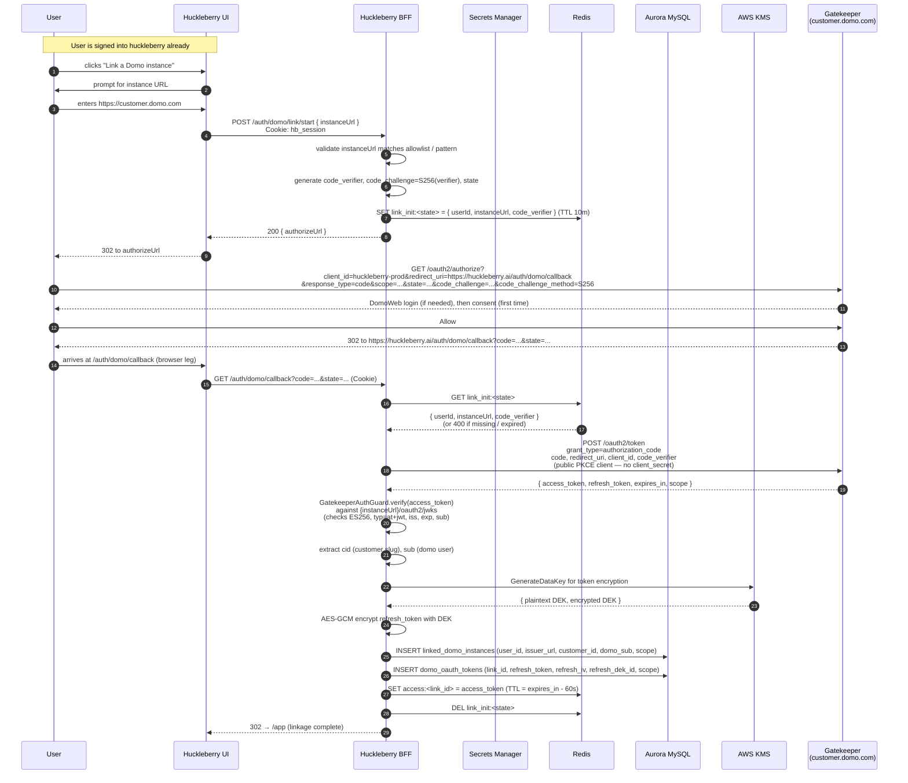
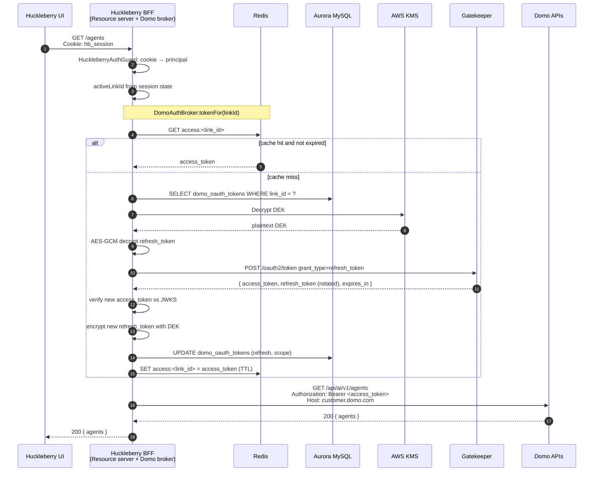

# Auth Flows — Huckleberry Identity + Domo OAuth Linkage

Two distinct flows in one diagram set. They serve different purposes and must not be conflated:

- **Layer A — Huckleberry identity.** Sign-up, sign-in, session. We own this end-to-end. No Domo involvement.
- **Layer B — Domo OAuth linkage.** Standard OAuth 2.1 authorization-code + PKCE flow against each customer's Gatekeeper instance. **The BFF is a public PKCE client** (`token_endpoint_auth_method=none`) — no `client_secret` to store. The only Domo material persisted per user is the refresh token (encrypted-at-rest in Aurora, rotated on every use per OAuth 2.1).

See `../authentication.md` for the design rationale, table schemas, and module surface.

## Layer A — Huckleberry sign-in (magic-link)

Two distinct entry points:

- **Sign-up** (`POST /api/auth/signup`): provisions a Domo instance + user via `InstanceProvisioner`, inserts the huckleberry user row in `pending_link` status, seeds a pending `linked_domo_instances` row (no tokens), and emails a magic-link. First sign-in completes the PKCE auth-code flow to mint the user's refresh token.
- **Sign-in** (`POST /api/auth/signin/request`): existing-users-only. Sends a magic-link if the email matches a row; silently no-ops otherwise. Always returns 202 (existence-oracle protection).

```mermaid
sequenceDiagram
    autonumber
    participant U as User
    participant FE as Huckleberry UI<br/>(huckleberry.ai)
    participant BFF as Huckleberry BFF
    participant DB as Aurora MySQL
    participant R as Redis
    participant SES as AWS SES

    Note over U,SES: Request magic-link
    U->>FE: enters email, clicks "Send me a sign-in link"
    FE->>BFF: POST /auth/signin/request { email }<br/>X-CSRF-Token: ...
    BFF->>BFF: rate-limit by email + IP
    BFF->>DB: SELECT users WHERE email = ? AND email_verified
    alt user exists and verified
        BFF->>BFF: generate random token (32 bytes), token_hash = SHA-256
        BFF->>DB: INSERT magic_links (token_hash, user_id, expires_at=NOW()+15m)
        BFF->>SES: send email with link huckleberry.ai/auth/signin?token=<raw>
    end
    BFF-->>FE: 202 (regardless of existence — don't leak)
    FE-->>U: "Check your inbox"

    Note over U,R: Consume the link
    U->>FE: clicks email link → /auth/signin?token=...
    FE->>BFF: GET /auth/signin?token=...
    BFF->>BFF: token_hash = SHA-256(token)
    BFF->>DB: SELECT magic_links WHERE token_hash AND consumed_at IS NULL AND expires_at > NOW()
    alt valid
        BFF->>DB: UPDATE magic_links SET consumed_at=NOW() WHERE token_hash AND consumed_at IS NULL
        Note over BFF,DB: Atomic — affected rows = 1 means we won the race
        BFF->>DB: UPDATE users SET email_verified=1, last_login_at=NOW()
        BFF->>R: SET session:<sid> = { userId, exp } (TTL 12h)
        BFF-->>FE: Set-Cookie: hb_session=<HS256 JWT { sub, sid, exp }><br/>HttpOnly; Secure; SameSite=Lax
        BFF-->>FE: Set-Cookie: csrf_token=<random><br/>Secure; SameSite=Lax (NOT HttpOnly)
        alt user.status == 'pending_link'
            BFF-->>FE: 302 → /auth/domo/link/start (forced OAuth handoff)
        else
            BFF-->>FE: 302 → /app
        end
    else
        BFF-->>FE: 400 invalid_or_expired_token
    end

    Note over U,R: Subsequent requests
    U->>FE: any app action
    FE->>BFF: GET /something<br/>Cookie: hb_session=...<br/>X-CSRF-Token: <echo of csrf_token cookie>
    BFF->>BFF: HuckleberryAuthGuard:<br/>verify cookie JWT signature
    BFF->>R: GET session:<sid>
    R-->>BFF: { userId, exp } or null → 401
    BFF->>BFF: CSRF guard (state-changing routes only)
    BFF->>BFF: attach HuckleberryPrincipal { userId, sessionId, activeLinkId? }

    Note over U,R: Sliding TTL
    BFF->>R: EXPIRE session:<sid> 12h<br/>(extend on every valid request)

    Note over U,R: Sign out
    U->>FE: POST /auth/logout (Cookie + X-CSRF-Token)
    FE->>BFF: POST /auth/logout
    BFF->>R: DEL session:<sid>
    BFF-->>FE: Set-Cookie: hb_session=; Max-Age=0<br/>Set-Cookie: csrf_token=; Max-Age=0
```

The very first magic-link click does double duty: marks the user `email_verified=1` and issues their first session. No separate "verify email then come back to sign in" round-trip.

## Layer B — Linking a Domo instance



## Per-request — using a linked Domo instance



## Refresh-token rotation + reuse detection

Gatekeeper enforces single-use refresh tokens. Every refresh exchange:

1. Invalidates the presented refresh token.
2. Issues a new access + refresh pair.
3. Stores the prior refresh value so replay is detectable.

If the BFF presents a rotated-out refresh token, Gatekeeper **cascade-revokes the entire authorization** — every live token from that row stops working immediately. Practical implication for our `domo_oauth_tokens` table:

- Every refresh response _must_ atomically overwrite the stored refresh token. If the write fails after the exchange succeeded, we've lost the new refresh and the link is effectively dead.
- Implement the write as a `BEGIN TRANSACTION; UPDATE ...; COMMIT;` with a guaranteed-durable Aurora write — and if it errors, surface to the user as "Re-link your Domo account."
- Never retry a failed refresh with the same refresh token. The reuse signal is fatal at Gatekeeper.

## Endpoints we use against Gatekeeper

| Purpose                    | Path                                          |
| -------------------------- | --------------------------------------------- |
| Authorization              | `GET /oauth2/authorize`                       |
| Token (auth code, refresh) | `POST /oauth2/token`                          |
| JWKS                       | `GET /oauth2/jwks`                            |
| Revocation                 | `POST /oauth2/revoke`                         |
| Discovery                  | `GET /.well-known/oauth-authorization-server` |
| UserInfo (optional)        | `GET /userinfo`                               |

All paths live on the tenant hostname (`https://{customer}.domo.com`). The BFF discovers them once per linked instance at startup (cached) rather than hardcoding paths.

## Client registration — confidential, not public

Huckleberry registers with Gatekeeper as a **public PKCE OAuth 2.1 client**:

| Field                        | Value                                                                                                                                                                        |
| ---------------------------- | ---------------------------------------------------------------------------------------------------------------------------------------------------------------------------- |
| `client_name`                | `Huckleberry`                                                                                                                                                                |
| `redirect_uris`              | `https://huckleberry.ai/auth/domo/callback`, plus staging/dev variants                                                                                                       |
| `grant_types`                | `["authorization_code", "refresh_token"]`                                                                                                                                    |
| `response_types`             | `["code"]`                                                                                                                                                                   |
| `token_endpoint_auth_method` | `none` (public PKCE client)                                                                                                                                                  |
| `scope`                      | union of all scopes we ever request across features — `ai:read ai:execute content:meta:read content:data:read dataset:meta:read dataset:data:read identity:read search:read` |

There is no `client_secret`. PKCE (S256 code-challenge) is the proof-of-possession. The verifier never leaves the BFF — it's stored in the `OAuthStateStore` keyed by `state` for the duration of the round-trip.

Open question: does each Domo customer require us to register separately, or does one global Gatekeeper registration work across all customer instances? The Postman collection registers per-instance via `POST /oauth2/register`; we likely need one registration per allowed customer. Track this with the Gatekeeper team.

## Correctness rules for the BFF-side OAuth implementation

1. **Always overwrite `domo_oauth_tokens.refresh_token` from every refresh response.** OAuth 2.1 mandates rotation; treat every response as authoritative.
2. **Verify the access token via JWKS before persisting.** Even though we just exchanged a code for it, an invalid token means we have nothing useful to store. Use `GatekeeperAuthGuard.verify` (now factored to be reusable internally).
3. **Validate `iss` and `aud` claims** as part of #2. Reject if the token's `iss` doesn't match the `instanceUrl` we initiated the flow against.
4. **On any refresh failure (401 / `invalid_grant`), mark the link as broken.** The user must re-link to recover. Cascade-revocation makes this a one-way door.
5. **Single bearer-injection point in DomoProxy.** All outbound Domo calls go through `DomoProxyService` with `{ targetHost, bearer }`.
6. **Reject `?access_token=` query parameters** inbound. We never accept tokens via URL — only via the huckleberry session cookie (Layer A) or as `Authorization: Bearer` on internal proxy calls.
7. **Never log full tokens.** Log `jti` claim or first 8 chars of the signature only. KMS-encrypt tokens at rest, even in dev (use a local KMS or LocalStack for parity).
8. **Exact redirect URI match.** `/auth/domo/callback` is the only valid callback path; no trailing slashes, no path params.
9. **Bind the OAuth `state` to the huckleberry session.** The `state` lookup in Redis must include the `userId` from the session cookie — a callback hitting our endpoint without the matching huckleberry session is rejected.

## Why this is the right model for standalone huckleberry.ai

- Users sign in once with a huckleberry credential. Their session survives Domo session expiries.
- One huckleberry user can link multiple Domo instances and switch without re-authing each one.
- Refresh tokens live server-side, so we can do background work (memory extraction, scheduled jobs) on behalf of the user when the browser is closed.
- The PKCE verifier lives only inside the BFF process — never reaches the browser. The SPA's job ends at the authorize redirect; the callback hits the BFF directly.
