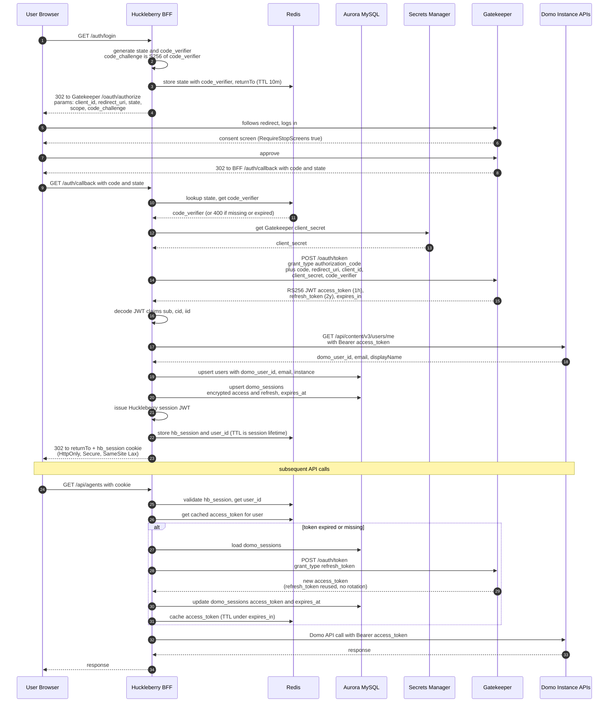

# Domo OAuth Flow (Authorization Code + PKCE via Gatekeeper)

Huckleberry registers as an OAuth 2.1 client in **Gatekeeper** — Domo's new internal OAuth 2.1 authorization server, replacing the older Gatekeeper.

Server-side authorization code flow. Huckleberry's NestJS backend is a **confidential client** — `client_secret` lives in Secrets Manager and never leaves the server. PKCE is mandatory under OAuth 2.1 (binds the code to the originating session so a stolen code can't be redeemed).

## Gatekeeper client registration

Confirm registration mechanism with the Gatekeeper team. Proposed client metadata:

| Field | Value | Why |
|---|---|---|
| `ID` | `huckleberry` (or per Gatekeeper naming convention — confirm) | Single client identifier; convention TBD with Gatekeeper team |
| `Secret` | UUID issued by Gatekeeper, stored in AWS Secrets Manager | `[]string` shape lets Gatekeeper rotate by appending a new secret then removing the old |
| `Name` | `Huckleberry` | Display name on consent / stop screens |
| `Internal` | `true` | Domo-built, internal-use |
| `Confidential` | `true` | NestJS backend can hold a secret; not a public client |
| `RequireStopScreens` | `true` | Matches precedent for confidential server apps (Workbench, ARC, Coursebuilder) |
| `RedirectURIs` | `http://localhost:3000/auth/callback`, `https://huckleberry-staging.<domain>/auth/callback`, `https://huckleberry.<domain>/auth/callback` | Dev, staging, prod callbacks |

## Sequence

## Why this flow

- **Authorization code with confidential client** — backend keeps `client_secret`, tokens never touch the browser
- **PKCE included as forward-compat** — Gatekeeper accepts but doesn't enforce today; harmless to send
- **`state` parameter** — CSRF protection on the callback; also doubles as the lookup key for the per-flow `code_verifier`
- **Tokens encrypted at rest** — KMS-backed envelope encryption on `domo_sessions.access_token` / `refresh_token`
- **Redis as token cache** — avoids a DB read on every Domo API call; falls back to DB on miss
- **Single client registration** — Huckleberry is one app talking to one Gatekeeper (Domo's auth server), not per-instance. `instance` is a property of the user, not the OAuth client

## Gatekeeper facts (confirmed against `~/dev/heimdall`)

### Endpoints
| Purpose | Path | File |
|---|---|---|
| Authorization | `/oauth/authorize` | `main.go:148` |
| Token | `/oauth/token` | `main.go:149` |
| Revocation (RFC 7009) | `/oauth/revoke` | `main.go:150` |
| Introspection (RFC 7662) | `/oauth/introspect` | `main.go:151` |
| Userinfo (Gatekeeper only) | `/userinfo` (proxied) | `route_product.go:196` |
| Discovery | `/.well-known/*` (proxied to Gatekeeper, allowlisted customers only) | `route_product.go:195` |

### Tokens (assumed; confirm with Gatekeeper team)
- **Format**: RS256-signed JWTs; decodable for claims (`jti`, `sub`, `aud`, `exp`, `scope`, `cid`, `iid`, `sid`)
- **Access token TTL**: short-lived (1h target)
- **Refresh token TTL**: long-lived; **OAuth 2.1 mandates rotation** — every refresh response yields a new refresh_token
- **PKCE**: mandatory under OAuth 2.1; both `/authorize` and `/token` enforce it

### Scopes (proposed; confirm with Gatekeeper team)
| Endpoint Huckleberry calls | Scope to request |
|---|---|
| Mako `/api/ai/v1/agents/*` (agents, execute, sessions) | `ai-services` |
| Mako `/api/ai/v1/memory/*` (memory admin) | `ai-services` |
| Mako `/api/ai/v1/text/*` | `ai-services` |
| Mako `/api/recall/v1/*` (graph nodes) | `ai-services` |
| `/api/content/v3/*` (users, groups) | `content` |
| `/api/content/v3/users/me` | `user-profile` |
| `/api/identity/v1/*` | `identity` (or `content`) |
| `/api/data/v3/*` (datasources) | `data` |

**Recommended scope set:** `ai-services content data user-profile`. Avoid `user` / `identity` unless we mutate users.

### Bearer token against Domo APIs
The Gatekeeper-issued Bearer JWT is the canonical credential for downstream Domo (and Mako) API calls. Drop `x-domo-developer-token` / `x-domo-eps-auth-token` from DomoProxy when Huckleberry is wired up — replace with `Authorization: Bearer <gatekeeper_jwt>`.

### Identity propagation
1. **Decode + verify JWT claims** — `sub` is the user ID, `cid` is customer, `iid` is instance. Cheap. No network call. (Verification mandatory — see correctness rules in `auth-providers.md`.)
2. **Call `/api/content/v3/users/me`** with `user-profile` scope to get email + display name. Once at login, persist on `users` row.

Use both: claims for fast per-request identity, `/users/me` once at login for profile data.

### Discovery
Gatekeeper as OAuth 2.1 should expose a discovery endpoint (`/.well-known/oauth-authorization-server` or OIDC equivalent). Fetch + cache at boot to avoid hardcoded endpoint paths. Confirm path with the Gatekeeper team.

## Implementation implications

1. **Drop the `DomoAuthProvider` swappable seam.** Single provider implementation against Gatekeeper.
2. **Refresh logic**: OAuth 2.1 requires refresh-token rotation — always overwrite `domo_sessions.refresh_token` from the response.
3. **Schema**: `oauth_tokens.refresh_token` is always populated (no NULL case).
4. **PKCE is mandatory** — send and validate `code_challenge` / `code_verifier` end-to-end.

## OAuth 2.1 — what we build

Gatekeeper is OAuth 2.1 native. The "build now vs defer" framing from the prior Heimdall era simplifies — most items are simply correctness requirements.

### Required (correctness, not optional)

| # | What |
|---|---|
| 1 | **Always overwrite `domo_sessions.refresh_token` from the refresh response.** OAuth 2.1 mandates rotation. |
| 2 | **Verify RS256 JWT signature against Gatekeeper's JWKS** before trusting any claim. JWKS fetched at boot, cached, used on every decode. |
| 3 | **Validate `iss` and `aud` claims** on every JWT we accept. |
| 4 | **On refresh `/token` → 401 (or `invalid_grant`)**, immediately invalidate the user's `hb_session` and force re-login. |
| 5 | **Single `verifyAndDecodeAccessToken(jwt)` function** used everywhere. |
| 6 | **Single `injectBearer(req)` function in DomoProxy** for outbound auth. |
| 7 | **Persist granted `scope` on `domo_sessions`**; re-auth when scope set changes. |
| 8 | **Reject bearer tokens from query strings.** OAuth 2.1 forbids `?access_token=`. |
| 9 | **Exact redirect URI matching** at our `/auth/callback`. |
| 10 | **PKCE end-to-end** — generate `code_verifier` per flow, send `code_challenge` to `/authorize`, send `code_verifier` to `/token`. |

### Deferred (confirm with Gatekeeper team)

| # | What | Trigger to revisit |
|---|---|---|
| A | **DPoP / sender-constrained tokens** | Gatekeeper supports DPoP (RFC 9449) and a high-value feature requires it |
| B | **Front-channel / back-channel logout** | Gatekeeper publishes session-end notifications |
| C | **Periodic introspection probes** of access tokens | High-sensitivity feature lands |
| D | **Multi-device / multi-session per user** (1:N `domo_sessions`) | First user complaint or external-customer phase |
| E | **mTLS client auth** to Gatekeeper token endpoint | Gatekeeper mandates, or high-value-target deployment |
| F | **Refresh-token-at-rest hashing** | n/a — encryption + KMS is the right primitive |
| G | **Token introspection endpoint** for inbound bearer auth | Huckleberry exposes APIs that accept Gatekeeper bearers directly |
