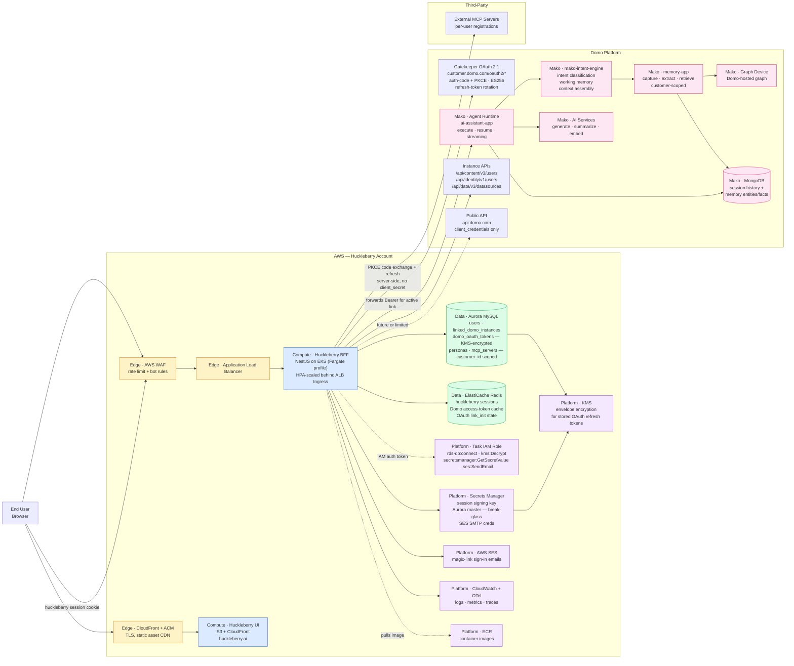

# System Overview — Huckleberry, AWS, Domo

High-level view of the deployed system. Shows where Huckleberry runs in AWS, which AWS services back it, and which Domo surfaces it talks to. Auth-flow specifics live in the auth diagrams; this one is about the boxes and the wires between them.

## Diagram

## Where each piece lives

### Huckleberry (AWS)

| Component        | AWS service                | Purpose                                                                                                                                   |
| ---------------- | -------------------------- | ----------------------------------------------------------------------------------------------------------------------------------------- |
| UI               | S3 + CloudFront            | Static SPA served from `huckleberry.ai`. Talks to the BFF only — never directly to Gatekeeper or Domo                                     |
| BFF              | EKS (Fargate profile) + ALB Ingress | NestJS API. Owns huckleberry identity (Layer A) + Domo OAuth broker (Layer B). HorizontalPodAutoscaler scales pods on CPU + request rate |
| Primary DB       | Aurora MySQL               | `users`, Domo linkage, `domo_oauth_tokens` (KMS-encrypted), Category B app data. All app rows `customer_id`-scoped                        |
| Cache + sessions | ElastiCache Redis          | Huckleberry server-side sessions (revocable), Domo access-token cache, PKCE `link_init` state                                             |
| AWS auth         | Task IAM Role              | Aurora IAM auth, Secrets Manager reads, KMS decrypt, SES send. No long-lived AWS secrets in the container                                 |
| Secrets          | Secrets Manager + KMS      | Session JWT signing key, Aurora master (break-glass), SES SMTP credentials. KMS for envelope-encrypted OAuth refresh tokens at rest. (No Gatekeeper `client_secret` — BFF is a public PKCE client.) |
| Email            | AWS SES                    | Magic-link sign-in emails                                                                                                                 |
| Edge             | CloudFront + WAF + ACM     | TLS termination, DDoS / rate-limit, bot rules                                                                                             |
| Observability    | CloudWatch + OpenTelemetry | Logs, metrics, traces                                                                                                                     |
| Image registry   | ECR                        | BFF container images                                                                                                                      |

### Domo Platform

| Surface                                            | Auth                                                                                    | What Huckleberry uses it for                                                                                                                     |
| -------------------------------------------------- | --------------------------------------------------------------------------------------- | ------------------------------------------------------------------------------------------------------------------------------------------------ |
| Gatekeeper `/oauth2/{authorize,token,jwks,revoke}` | auth code + PKCE (OAuth 2.1, ES256). **Public PKCE client** — `token_endpoint_auth_method=none`, no client_secret. Per-instance registration | BFF runs the OAuth flow server-side when a user links an instance; refreshes Domo tokens on demand and verifies them against the instance's JWKS |
| Mako: `/api/ai/v1/agents/*`                        | Bearer JWT (Gatekeeper)                                                                 | Agent execute, resume, streaming, CRUD                                                                                                           |
| Mako: `/api/ai/v1/memory/*`                        | Bearer JWT, Bedrock customer-scoped                                                     | Memory admin (read what's remembered, right-to-forget)                                                                                           |
| Mako: `/api/ai/v1/text/*`                          | Bearer JWT                                                                              | Text generation, summarization, text-to-SQL                                                                                                      |
| Mako: `/api/ai/v1/toolkits/*`                      | Bearer JWT                                                                              | Toolkit CRUD                                                                                                                                     |
| Mako: `/api/recall/v1/*`                           | Bearer JWT                                                                              | Knowledge graph nodes (read path)                                                                                                                |
| `/api/content/v3/*`, `/api/identity/v1/*`          | Bearer JWT                                                                              | Users, groups, current user                                                                                                                      |
| `/api/data/v3/*`                                   | Bearer JWT                                                                              | Datasources, schemas, queries                                                                                                                    |
| `api.domo.com` (public)                            | `client_credentials` OAuth                                                              | Limited — does not expose AI/memory/recall endpoints                                                                                             |

### Third-party

| Component            | Owned by | Purpose                                                |
| -------------------- | -------- | ------------------------------------------------------ |
| External MCP servers | per-user | Tool execution surfaces registered through MCP service |

## Things this diagram is deliberately not showing

- The internal NestJS module breakdown — see `auth-architecture.md`
- Auth sequence details — see `oauth-flow.md`
- OAuth client shape — see `auth-providers.md`
- Memory architecture detail (capture, extraction, retrieval pipeline) — see `memory-architecture.md`
- CI/CD pipeline (GitHub Actions → ECR → EKS rollout) — out of scope for system context
- Mako's internal module composition (ai-app, ai-assistant-app, recall-app, synapse-app, etc.)
