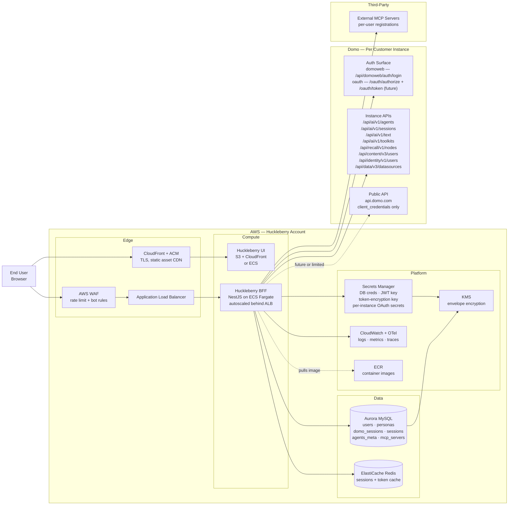

# System Overview — Huckleberry, AWS, Domo

High-level view of the deployed system. Shows where Huckleberry runs in AWS, which AWS services back it, and which Domo surfaces it talks to. Auth-flow specifics live in the auth diagrams; this one is about the boxes and the wires between them.

## Diagram

## Where each piece lives

### Huckleberry (AWS)

| Component | AWS service | Purpose |
|---|---|---|
| UI | S3 + CloudFront (or ECS if SSR) | Static frontend, edge-cached |
| BFF | ECS Fargate behind ALB | NestJS API, scales horizontally |
| Primary DB | Aurora MySQL | Users, tenants, personas, tokens, sessions |
| Cache | ElastiCache Redis | Hot session lookups, Domo token cache |
| Secrets | Secrets Manager + KMS | OAuth client secrets, JWT signing key, token encryption key |
| Edge | CloudFront + WAF + ACM | TLS termination, DDoS / rate-limit, bot rules |
| Observability | CloudWatch + OpenTelemetry | Logs, metrics, traces |
| Image registry | ECR | BFF container images |

### Domo (per-instance, customer-owned)

| Surface | Auth | What Huckleberry uses it for |
|---|---|---|
| `/api/domoweb/auth/login` | plaintext creds (today) | User authentication — domoweb provider |
| `/oauth/authorize` + `/oauth/token` (instance) | auth code + PKCE (future) | User authentication — oauth provider |
| `/api/ai/v1/*` | session / dev token | Agents, sessions, text generation, toolkits |
| `/api/recall/v1/*` | session / dev token | Knowledge graph nodes |
| `/api/content/v3/*`, `/api/identity/v1/*` | session / dev token | Users, groups, current user |
| `/api/data/v3/*` | session / dev token | Datasources, schemas, queries |
| `api.domo.com` (public) | `client_credentials` OAuth | Limited — does not expose AI/recall endpoints |

### Third-party

| Component | Owned by | Purpose |
|---|---|---|
| External MCP servers | per-user | Tool execution surfaces registered through MCP service |

## Things this diagram is deliberately not showing

- The internal NestJS module breakdown — see `auth-architecture.md`
- Auth sequence details — see `domoweb-auth-flow.md` and `oauth-flow-future.md`
- The provider seam — see `auth-providers.md`
- CI/CD pipeline (GitHub Actions → ECR → ECS) — out of scope for system context
- Neo4j / mem0 — referenced in config but not currently wired into the running system
