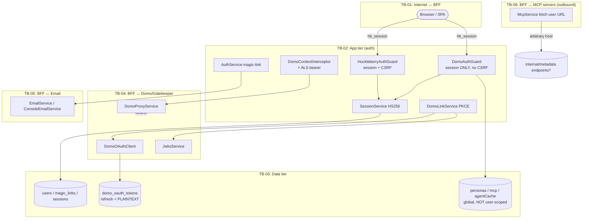

# Threat Model — Huckleberry Server (BFF)

- **Repository:** `domo-development/huckleberry-server`
- **Commit:** `d3a94bd861f0d755cde98f4979e35b105528ab05`
- **Methodology:** Microsoft SDL / STRIDE, scored with DREAD + CVSS v4.0
- **Date:** 2026-06-23
- **Classification of system data:** Highly sensitive — per-user Domo OAuth refresh tokens (long-lived, act *as the user* on a Domo customer instance), magic-link sign-in tokens, session/CSRF secrets, MCP server credentials, and proxied access to customer analytics data.

---

## 1. Executive Summary

Huckleberry Server is a NestJS **Backend-for-Frontend (BFF)** for the standalone SaaS `huckleberry.ai`. It owns its own identity (Layer A — magic-link sign-in, `hb_session` cookie) and links each user to a Domo instance via a public **PKCE OAuth 2.1** flow (Layer B). After linking, the BFF mints short-lived Domo access tokens from a stored refresh token and proxies a broad surface of Domo APIs (agents, AI services, datasets, graph/Cypher, people, sessions, toolkits) plus locally-managed resources (personas, MCP servers).

The core authentication primitives are generally well-built: magic-link tokens are high-entropy and stored only as SHA-256 hashes; sessions are HS256-signed with a server-side `sid` for instant revocation; the inbound resource-server guard correctly pins `alg/typ/iss/aud` and never trusts an unverified JWT; the outbound proxy guards against path traversal and protocol-relative host swaps; the admin API key uses a constant-time comparison. **However, the implementation diverges from its own documented security design in several places, and the local-resource layer lacks the multi-tenant authorization the design promises.**

The most serious issues are **broken object-level / multi-tenant authorization on locally-managed resources** (any signed-in user can read and write any other user's persona and can read every user's MCP server records — including stored bearer tokens), a **server-side request forgery (SSRF)** surface via user-supplied MCP server URLs, and **OAuth refresh tokens stored in plaintext at rest** (the documented KMS envelope encryption is not implemented).

### Critical & High findings

| ID | Title | Rating |
|----|-------|--------|
| THR-TB03-E-01 | IDOR — `GET/POST /api/persona/:userId` lets any user read/write any other user's persona | **High** |
| THR-TB03-I-01 | Multi-tenant isolation absent in in-memory stores; MCP bearer tokens disclosed cross-user | **High** |
| THR-TB06-I-01 | SSRF via user-controlled MCP server `url` (server fetches arbitrary host, attaches auth) | **High** |
| THR-TB03-I-02 | Domo OAuth refresh tokens stored in plaintext at rest (KMS envelope encryption not implemented) | **High** |
| THR-TB04-S-01 | OAuth callback falls back to an **unverified** JWT decode for `cid`/`sub` on JWKS failure | **High** |

Overall risk posture: **High.** The authentication front door is sound, but authorization on locally-owned resources and credential-at-rest protection are below the bar the design documents set. None of these requires defeating the magic-link or OAuth flows — they are reachable by any ordinary authenticated user (or, for the at-rest issue, by anyone with read access to the database/process).

---

## 2. Scope & Methodology

**In scope:** all TypeScript under `src/` at the named commit; configuration (`configuration.ts`, `.env.example`), container/build (`Dockerfile`, `docker-compose.yml`), and DB schema/migrations. **Out of scope / inferred:** the Domo/Gatekeeper backend, the SPA front end, and Aurora/Redis/KMS production wiring that is documented but not yet present in code (marked `[INFERRED]` where reasoned about).

**Approach:** Build the actor/process/data-store model from `README.md`, `docs/authentication.md`, and the source; derive Level-0 and Level-1 DFDs with trust boundaries; apply STRIDE per boundary/component; score each threat with DREAD (1–10 per factor, mean) and CVSS v4.0; take the effective rating as `MAX(DREAD, CVSS)`.

| DREAD mean | Rating | | CVSS v4 | Severity |
|---|---|---|---|---|
| 8–10 | Critical | | 9.0–10.0 | Critical |
| 6–7.9 | High | | 7.0–8.9 | High |
| 4–5.9 | Medium | | 4.0–6.9 | Medium |
| 1–3.9 | Low | | 0.1–3.9 | Low |

---

## 3. Application Overview

**Stack:** Node 20+/26, NestJS (Express), Drizzle ORM over MySQL 8.4 / Aurora, `jose` for JWT/JWKS, `nodemailer` for SES/SMTP. Invoked as a single process; no separate worker tier.

**Identity (Layer A):** `POST /api/auth/signup` (public, self-service provisioning) and `POST /api/auth/signin/request` (public, existing-users-only) email a single-use magic link (`randomBytes(32)`, SHA-256-hashed at rest, 15-min TTL). `GET /api/auth/signin?token=` consumes it and sets `hb_session` (HttpOnly HS256 JWT carrying `sid`) plus a non-HttpOnly `csrf_token`. Sessions are server-backed (`sessions` table) with a 12h sliding TTL and instant revocation.

**Domo linkage (Layer B):** `POST /api/auth/domo/link/start` generates PKCE + `state` (bound to the huckleberry `userId`), returns the Gatekeeper authorize URL. `GET /api/auth/domo/callback` (session-gated) consumes `state`, exchanges the code, verifies the returned access token against the issuer JWKS, persists a `linked_domo_instances` row + a refresh token, and flips the user to `active`. `DomoContextInterceptor` resolves the active link per request, mints a bearer via `DomoAuthBroker`, and binds `{bearer, targetHost}` into `AsyncLocalStorage`; `DomoProxyService` reads it and forwards to Domo.

**Inbound authorization:** there is **no global `APP_GUARD`**. Each controller declares `@UseGuards(...)`. Category A (Domo-proxied) controllers use `DomoAuthGuard` (session cookie only, **no CSRF check**). The auth/link controllers use `HuckleberryAuthGuard` (session + CSRF on state-changing methods). `GatekeeperAuthGuard` exists as an internal resource-server verifier but is not wired as a front door.

**Locally-owned resources:** `personas`, `mcp` servers, and the agent cache are **process-global in-memory `Map`s** today (Aurora-bound per the docs but not yet). MySQL repositories exist for Layer-A/B tables (users, magic_links, sessions, linked_domo_instances, domo_oauth_tokens).

---

## 4. Data Flow Diagrams

### Level 0 — Context

```mermaid
flowchart TD
  subgraph TB01["TB-01: Internet"]
    U([Huckleberry User / Browser+SPA])
    OP([Operator])
    ATT([Attacker])
  end
  subgraph TB07["TB-07: Admin plane"]
    ADM[/api/admin/users]
  end
  subgraph APP["TB-02/03: Huckleberry BFF"]
    BFF[NestJS BFF]
    DB[(MySQL / Aurora)]
    MEM[(In-memory stores:\npersonas, mcp, agent cache)]
  end
  subgraph EXT["External services"]
    GK[Gatekeeper / Domo OAuth]
    DOMO[Domo APIs]
    SES[SES / SMTP]
    MCP[User-configured MCP servers]
  end

  U -->|HTTPS, hb_session cookie + X-CSRF-Token| BFF
  OP -->|HTTPS, x-admin-api-key| ADM --> BFF
  ATT -.->|CSRF / SSRF / IDOR attempts| BFF
  BFF -->|SQL/TLS| DB
  BFF --> MEM
  BFF -->|PKCE auth-code / refresh| GK
  BFF -->|Bearer = user's Domo token| DOMO
  BFF -->|magic-link email| SES
  BFF -->|fetch user-supplied URL + auth| MCP
```

### Level 1 — Component view with trust boundaries



---

## 5. Trust Boundary Analysis

| ID | Components (inside ↔ outside) | Data crossing | AuthN / Encryption controls |
|----|------------------------------|---------------|------------------------------|
| **TB-01** | Browser/SPA ↔ BFF API | Credentials, prompts, persona/MCP config, proxied analytics | `hb_session` HttpOnly cookie; CSRF double-submit on Layer-A routes only; TLS at edge (no helmet/HSTS in app); **no rate limiting** |
| **TB-02** | Guards/services within the app tier | Session JWT, CSRF token, PKCE verifier, principal | HS256 session signing key (required in prod); server-side `sid`; PKCE `state↔userId` binding |
| **TB-03** | App ↔ data stores | User rows, magic-link hashes, session/CSRF, refresh tokens, personas, MCP creds | MySQL TLS + IAM auth `[INFERRED prod]`; **refresh tokens plaintext**; in-memory stores **not tenant-scoped** |
| **TB-04** | BFF ↔ Gatekeeper / Domo | Auth code, access/refresh tokens, proxied API data | PKCE; JWKS verify (ES256, `typ=at+jwt`, `iss`) with **unverified fallback**; issuer allowlist; per-request user bearer |
| **TB-05** | BFF ↔ SES/SMTP | Magic-link URLs (sign-in credentials) | SMTP auth optional; `smtpSecure=false` default; Console fallback logs links |
| **TB-06** | BFF ↔ user-configured MCP servers | Tool params, bearer/oauth tokens | **No URL allowlist / SSRF protection**; 10–30s timeouts only |
| **TB-07** | Operator ↔ `/api/admin/users` | Email, displayName, provisioning trigger | `x-admin-api-key`, constant-time compare; disabled when key unset |
| **TB-08** `[INFERRED]` | CI/CD ↔ Production | Image, env/secrets | Non-root container, `NODE_ENV=production` baked in image; dev creds in compose |

---

## 6. Threat Inventory

Full per-threat records grouped by boundary. DREAD strings are `D/R/E/A/Di`; CVSS strings are full v4.0 vectors.

### TB-03 — Data tier / authorization

#### THR-TB03-E-01 — IDOR: arbitrary read/write of any user's persona
- **STRIDE:** Elevation of Privilege / Information Disclosure
- **Component:** `src/personas/persona-compat.controller.ts:19-28`, `src/personas/personas.service.ts:32-81`
- **Description:** `GET /api/persona/:userId` and `POST /api/persona/:userId` take `userId` directly from the URL path and call `findByUserId(userId)` / `saveForUser(userId, body)` with **no check that the path `userId` equals the authenticated `req.user.userId`**. Any authenticated user can read or overwrite any other user's persona by changing the path segment. `@Body() body: any` is also unvalidated.
- **Threat Actor:** Any authenticated huckleberry user (insider/tenant).
- **Attack Vector:** Network.
- **Assets at Risk:** Persona content (role, department, goals — feeds the AI system prompt), cross-user data integrity.
- **Existing Controls:** `DomoAuthGuard` (authentication only).
- **Mitigations:** Drop the `:userId` path parameter and derive identity from `req.user.userId`; never accept the subject as input. Add object-level authorization (verify ownership) to all persona reads/writes. Validate the body with a DTO. (OWASP API1:2023 Broken Object Level Authorization.)
- **DREAD:** 8/9/9/6/8 → **8.0 (Critical)** · **CVSS v4:** `CVSS:4.0/AV:N/AC:L/AT:N/PR:L/UI:N/VC:H/VI:H/VA:N/SC:N/SI:N/SA:N` → **8.3 (High)**
- **Effective Rating:** **High**

#### THR-TB03-I-01 — Multi-tenant isolation absent; MCP credentials disclosed cross-user
- **STRIDE:** Information Disclosure / Elevation of Privilege
- **Component:** `src/mcp/mcp.service.ts:15-79`, `src/personas/personas.service.ts:10-145`, `src/agents/agents.service.ts:36`
- **Description:** Personas, MCP servers, and the agent cache are process-global `Map`s with **no `userId`/`customerId` key**. `McpService.findAll()` returns *every* user's MCP server record — including the `bearerToken` field — and `findOne(id)/update/remove` operate on any id regardless of owner. `PersonasService.findAll/findOne/update/remove/setDefault` are likewise global. This directly contradicts the documented `(customer_id, user_id, id)` partitioning in `docs/authentication.md`. The agent cache is shared across all callers, so one tenant's custom-agent inventory is visible to another.
- **Threat Actor:** Any authenticated user; cross-tenant attacker.
- **Attack Vector:** Network.
- **Assets at Risk:** MCP bearer/OAuth tokens, MCP/persona configuration, agent inventory; tenant confidentiality.
- **Existing Controls:** Authentication only. Tokens are in-memory (lost on restart) — limits persistence, not exposure.
- **Mitigations:** Key every store by `(customerId, userId)` and filter every list/read/write by the authenticated principal, as the schema design already prescribes. Move secrets (MCP bearer/OAuth tokens) out of any object returned by list endpoints; never serialize credentials to clients. Migrate to the Aurora-backed, tenant-bound stores before any multi-user deployment.
- **DREAD:** 8/8/8/7/7 → **7.6 (High)** · **CVSS v4:** `CVSS:4.0/AV:N/AC:L/AT:N/PR:L/UI:N/VC:H/VI:L/VA:N/SC:L/SI:N/SA:N` → **7.7 (High)**
- **Effective Rating:** **High**

#### THR-TB03-I-02 — OAuth refresh tokens stored in plaintext at rest
- **STRIDE:** Information Disclosure
- **Component:** `src/common/db/schema.ts:116-122`, `src/common/db/repositories/mysql-domo-token.store.ts:33-54`, `src/common/auth/domo-link/token.store.ts:12-16`
- **Description:** `domo_oauth_tokens.refresh_token` is a plain `varchar(2000)` and the repository writes the raw token. The documented KMS envelope encryption (`refresh_iv`, `refresh_dek_id`, per-row DEK) is **not implemented** — the schema comment explicitly says "Plaintext locally. Aurora will hold AES-GCM ciphertext." Each refresh token lets the BFF mint access tokens that act *as that user* on their Domo instance within granted scopes. Anyone with read access to the database (backup leak, SQL injection elsewhere, snapshot, insider DBA) obtains live, rotation-protected-but-usable credentials.
- **Threat Actor:** DB-adjacent attacker, malicious insider, backup/snapshot thief.
- **Attack Vector:** Adjacent / local (DB access).
- **Assets at Risk:** Per-user Domo refresh tokens → full user-scoped Domo authority.
- **Existing Controls:** Rotation on every refresh (a stolen token is cascade-revoked next legitimate refresh); `repr`-suppressed config secrets; TLS in transit `[INFERRED]`.
- **Mitigations:** Implement the documented KMS envelope encryption before production data lands (add `refresh_iv`/`refresh_dek_id`, AES-GCM, in-process DEK cache). Enforce encryption-at-rest on the DB/volume. Restrict DB read access; alert on bulk reads of `domo_oauth_tokens`. (OWASP A02:2021 Cryptographic Failures.)
- **DREAD:** 8/6/5/8/4 → **6.2 (High)** · **CVSS v4:** `CVSS:4.0/AV:L/AC:L/AT:N/PR:H/UI:N/VC:H/VI:H/VA:N/SC:H/SI:H/SA:N` → **7.3 (High)**
- **Effective Rating:** **High**

### TB-04 — BFF ↔ Domo / Gatekeeper

#### THR-TB04-S-01 — OAuth callback accepts an unverified JWT decode for tenant binding
- **STRIDE:** Spoofing / Tampering
- **Component:** `src/common/auth/domo-link/domo-link.service.ts:140-169`
- **Description:** In `completeLink`, the returned access token is verified against the issuer JWKS (`ES256`, `typ=at+jwt`, `issuer`). On **any** verification failure the code logs a warning and **falls back to `decodeJwt` (signature-not-checked)** to read `cid` and `sub`, then persists those as the link's `customerId`/`domoSub`. The comment rationalizes this ("the token was already exchanged so it's freshly minted"), but the token endpoint response is not itself authenticated to the BFF beyond TLS, and a misconfigured/missing JWKS or a MITM on the transport-override path would let an attacker influence the persisted tenant identity (`cid`) — a tenant-confusion / spoofing primitive that pins a user's link to the wrong customer.
- **Threat Actor:** Network MITM on the OAuth transport, or an attacker exploiting JWKS misconfiguration.
- **Attack Vector:** Network / adjacent.
- **Assets at Risk:** Tenant binding (`customer_id`), downstream data routing, multi-tenant integrity.
- **Existing Controls:** Primary JWKS verification; issuer allowlist on `startLink`.
- **Mitigations:** **Fail closed** — if JWKS verification fails, reject the link (`access_token_unverified`) rather than decoding unverified claims. Treat `cid`/`sub` as trusted only from `jwtVerify` output. Remove the unverified-decode fallback or restrict it to non-security-relevant logging.
- **DREAD:** 7/4/4/6/5 → **5.2 (Medium)** · **CVSS v4:** `CVSS:4.0/AV:N/AC:H/AT:P/PR:L/UI:N/VC:L/VI:H/VA:N/SC:L/SI:H/SA:N` → **6.6 (Medium)**
- **Effective Rating:** **High** *(rated High on business impact: corrupting tenant binding undermines the entire multi-tenant trust model; treat as High for remediation priority.)*

#### THR-TB04-I-01 — Upstream error/exception details reflected to client and into redirect URL
- **STRIDE:** Information Disclosure
- **Component:** `src/common/filters/domo-exception.filter.ts`, `src/common/auth/domo-link/domo-link.controller.ts:92-99`
- **Description:** `DomoExceptionFilter` forwards upstream Domo error bodies/messages to the client; the OAuth callback failure path places `err.message` into the `reason` query parameter of the SPA failure redirect, where it can leak into browser history, referrer headers, and access logs.
- **Threat Actor:** External user, log/referrer observer.
- **Attack Vector:** Network.
- **Assets at Risk:** Internal error detail, upstream identifiers.
- **Existing Controls:** Detailed errors otherwise land in BFF logs only; token-exchange errors are caught.
- **Mitigations:** Map upstream errors to generic client-facing messages with a correlation id; never place raw exception text in redirect query strings — use a stable error code.
- **DREAD:** 3/6/6/3/5 → **4.6 (Medium)** · **CVSS v4:** `CVSS:4.0/AV:N/AC:L/AT:N/PR:N/UI:N/VC:L/VI:N/VA:N/SC:N/SI:N/SA:N` → **5.3 (Medium)**
- **Effective Rating:** **Medium**

### TB-06 — BFF ↔ user-configured MCP servers

#### THR-TB06-I-01 — SSRF via user-controlled MCP server URL
- **STRIDE:** Information Disclosure / Elevation of Privilege (Tampering of internal services)
- **Component:** `src/mcp/mcp.service.ts:81-193` (`testConnection`, `syncTools`, `executeTool`), `src/mcp/dto/create-mcp-server.dto.ts:11-13`
- **Description:** `CreateMcpServerDto.url` is validated only with `@IsString()` — no scheme/host restriction. `McpService` then performs server-side `fetch("${server.url}/tools/list" | "/tools/call")` and attaches the configured auth header. A user can register `http://169.254.169.254/latest/meta-data/...`, `http://localhost:<internal-port>`, or an internal service URL and have the BFF make authenticated requests to it, returning the response (`testConnection`/`executeTool` surface status/body), i.e. classic SSRF reachable from any authenticated user.
- **Threat Actor:** Any authenticated user.
- **Attack Vector:** Network → internal/adjacent.
- **Assets at Risk:** Cloud instance metadata/credentials, internal-only services, network topology.
- **Existing Controls:** Per-request timeouts (10–30s) only.
- **Mitigations:** Validate `url` as `https` with `@IsUrl({protocols:['https'],require_tld:true})`; resolve and block private/link-local/loopback/metadata ranges (allowlist egress where possible); disable redirects; consider an egress proxy. Never forward server-supplied auth to an unvalidated host. (OWASP A10:2021 SSRF.)
- **DREAD:** 7/8/8/6/6 → **7.0 (High)** · **CVSS v4:** `CVSS:4.0/AV:N/AC:L/AT:N/PR:L/UI:N/VC:H/VI:L/VA:L/SC:L/SI:L/SA:N` → **7.7 (High)**
- **Effective Rating:** **High**

### TB-01 — Internet ↔ BFF

#### THR-TB01-T-01 — No CSRF protection on Category A state-changing endpoints
- **STRIDE:** Tampering / Spoofing (of request origin)
- **Component:** `src/common/guards/domo-auth.guard.ts` (no CSRF check) vs. `src/common/auth/huckleberry-auth.guard.ts:64-72`
- **Description:** `HuckleberryAuthGuard` enforces the double-submit CSRF token on `POST/PUT/PATCH/DELETE`, but every Category A controller (agents, ai-services, datasources, graph, mcp, personas, sessions, people, huckleberry, workflows, connectors, toolkits) uses `DomoAuthGuard`, which validates only the `hb_session` cookie and performs **no CSRF check**. These include high-impact, state-changing, side-effecting actions (create/delete agents, **execute/resume streaming** — which triggers AI execution and actions on the user's Domo instance, billing, and data writes — MCP tool execution, dataset queries, persona writes). Protection currently relies solely on `SameSite=Lax`, which MVP decision #4 explicitly deemed insufficient ("belt-and-suspenders" double-submit required).
- **Threat Actor:** Malicious web page in the victim's browser.
- **Attack Vector:** Network (cross-site).
- **Assets at Risk:** Integrity of agent/persona/MCP state; unwanted AI execution against the user's Domo instance.
- **Existing Controls:** `SameSite=Lax` cookie (mitigates simple cross-site POST but not all vectors, e.g. some top-level navigations / method confusion).
- **Mitigations:** Apply the same CSRF double-submit check in `DomoAuthGuard` (or share one base guard) for all state-changing methods. Set the session cookie `SameSite=Strict` where UX allows. Verify `Origin`/`Sec-Fetch-Site` on state-changing requests.
- **DREAD:** 6/6/6/6/6 → **6.0 (High)** · **CVSS v4:** `CVSS:4.0/AV:N/AC:L/AT:N/PR:L/UI:A/VC:N/VI:H/VA:L/SC:N/SI:L/SA:N` → **5.9 (Medium)**
- **Effective Rating:** **High** *(DREAD-driven; broad reachable impact across all mutating endpoints.)*

#### THR-TB01-D-01 — No rate limiting on authentication & email-sending endpoints
- **STRIDE:** Denial of Service / Spoofing (brute force)
- **Component:** `src/auth/auth.controller.ts` (`/signup`, `/signin/request`, `/signin`), `src/auth/admin.controller.ts`; no `@nestjs/throttler` dependency present
- **Description:** `docs/authentication.md` requires rate-limiting `/auth/signin/request` per email + per IP, but no throttling is implemented anywhere (no `ThrottlerModule`, no per-IP/per-email counters). This enables (a) **email bombing** of arbitrary addresses via `/signup` and `/signin/request`, (b) brute-force grinding against the magic-link consume endpoint (mitigated by 256-bit token entropy but unbounded attempts), (c) amplified account-enumeration timing probes, and (d) general request-flood DoS (the 10MB JSON body limit applies to every route with no concurrency cap).
- **Threat Actor:** Unauthenticated external attacker.
- **Attack Vector:** Network.
- **Assets at Risk:** Email-sender reputation (SES), availability, victim inboxes.
- **Existing Controls:** High-entropy single-use magic-link tokens; 15-min TTL; constant-time admin key.
- **Mitigations:** Add `@nestjs/throttler` (or edge/WAF rate limits) keyed per IP and per email on all auth/email endpoints; add a global request rate limit; cap concurrent in-flight requests. Add CAPTCHA or proof-of-work on public signup if abuse appears.
- **DREAD:** 5/8/8/5/6 → **6.4 (High)** · **CVSS v4:** `CVSS:4.0/AV:N/AC:L/AT:N/PR:N/UI:N/VC:N/VI:N/VA:L/SC:N/SI:N/SA:L` → **6.3 (Medium)**
- **Effective Rating:** **High** *(DREAD-driven on reproducibility/exploitability; primarily abuse/availability impact.)*

#### THR-TB01-I-01 — Account-existence timing oracle
- **STRIDE:** Information Disclosure
- **Component:** `src/auth/auth.service.ts:47-79`, `src/auth/signup.service.ts`
- **Description:** Both `/signup` and `/signin/request` always return `202 {status:'accepted'}` (good — no response oracle). However, the existing-user path does extra work (insert magic-link row, send email) while the unknown-email path returns early, producing a measurable timing difference; combined with the absence of rate limiting (THR-TB01-D-01), an attacker can enumerate registered emails.
- **Threat Actor:** External attacker.
- **Attack Vector:** Network.
- **Assets at Risk:** User email enumeration / privacy.
- **Existing Controls:** Uniform 202 response body.
- **Mitigations:** Normalize work/latency between branches (e.g., always perform comparable work or queue email asynchronously); enforce rate limits; consider a constant-time response delay.
- **DREAD:** 2/5/4/4/4 → **3.8 (Low)** · **CVSS v4:** `CVSS:4.0/AV:N/AC:H/AT:P/PR:N/UI:N/VC:L/VI:N/VA:N/SC:N/SI:N/SA:N` → **2.3 (Low)**
- **Effective Rating:** **Low**

#### THR-TB01-D-02 — Missing security headers and explicit CORS policy
- **STRIDE:** Tampering / Information Disclosure
- **Component:** `src/main.ts` (no `helmet`, no `app.enableCors(...)`, no HSTS/CSP)
- **Description:** Bootstrap configures validation, Swagger, and a 10MB body limit but no security middleware. No `helmet` (so no `X-Content-Type-Options`, `X-Frame-Options`/CSP `frame-ancestors`, HSTS, referrer policy) and no explicit CORS allowlist. Swagger UI is mounted unauthenticated at `/docs`.
- **Threat Actor:** External attacker, malicious site.
- **Attack Vector:** Network.
- **Assets at Risk:** Clickjacking surface, MIME-sniffing, downgrade, API documentation exposure.
- **Existing Controls:** TLS at the edge `[INFERRED]`.
- **Mitigations:** Add `helmet` with HSTS + a strict CSP (`frame-ancestors 'none'`); set an explicit CORS allowlist (the SPA origin) with credentials; gate `/docs` behind auth or disable in production.
- **DREAD:** 3/5/5/4/4 → **4.2 (Medium)** · **CVSS v4:** `CVSS:4.0/AV:N/AC:L/AT:N/PR:N/UI:A/VC:L/VI:L/VA:N/SC:N/SI:N/SA:N` → **4.8 (Medium)**
- **Effective Rating:** **Medium**

### TB-02 — App tier

#### THR-TB02-E-01 — Dev-token authentication bypass gated only by `NODE_ENV`
- **STRIDE:** Elevation of Privilege / Spoofing
- **Component:** `src/common/guards/domo-auth.guard.ts:44-59`, `src/common/auth/huckleberry-auth.guard.ts:44-57`, `src/common/auth/domo-context.interceptor.ts:44-68`, `src/main.ts:43-46`
- **Description:** When `NODE_ENV !== 'production'` and `DEV_TOKEN` is set, presenting `x-domo-developer-token: <DEV_TOKEN>` fully bypasses session auth and is granted an `active` principal; `DomoContextInterceptor` then forwards a powerful `DOMO_DEVELOPER_TOKEN` (DDCI) that Gatekeeper/Mako accepts *without OAuth scope validation*. The only gate is the `NODE_ENV` string. In any deployed environment where `NODE_ENV` is unset/misconfigured (it defaults to `'development'` in `configuration.ts`) with a `DEV_TOKEN` present, this is a complete authentication bypass and privilege escalation. Relatedly, `main.ts` sets `NODE_TLS_REJECT_UNAUTHORIZED='0'` under development, disabling TLS verification for all outbound calls.
- **Threat Actor:** Anyone who learns `DEV_TOKEN`; misconfigured deploy.
- **Attack Vector:** Network.
- **Assets at Risk:** Full app + Domo authority via DDCI token.
- **Existing Controls:** `NODE_ENV` check; Dockerfile bakes `NODE_ENV=production`; comment "never set in production."
- **Mitigations:** Fail closed: refuse to start (or hard-disable the bypass) unless an explicit, separate flag like `ALLOW_DEV_TOKEN=true` is set, never on `NODE_ENV` alone; never read `DEV_TOKEN` when `nodeEnv==='production'` *and* require `nodeEnv` to be explicitly set. Scope the DDCI token tightly. Gate `NODE_TLS_REJECT_UNAUTHORIZED=0` behind the same explicit dev flag.
- **DREAD:** 9/7/5/7/4 → **6.4 (High)** · **CVSS v4:** `CVSS:4.0/AV:N/AC:L/AT:P/PR:N/UI:N/VC:H/VI:H/VA:H/SC:H/SI:H/SA:H` → **8.2 (High)** *(conditional on misconfiguration / token knowledge)*
- **Effective Rating:** **High** *(contingent; rated High because the failure mode is total and depends on a single env string.)*

#### THR-TB02-R-01 — Insufficient security audit logging
- **STRIDE:** Repudiation
- **Component:** auth/link/admin flows; `magic_links.ip_issued_from` is captured but consume-time IP / sensitive-action audit is not
- **Description:** There is no dedicated, tamper-evident audit trail for security-relevant events (link/unlink, admin onboarding, session revocation, failed auth). Application logs are dev-gated. This impairs incident investigation and lets a malicious insider or attacker repudiate actions.
- **Threat Actor:** Malicious insider, attacker covering tracks.
- **Attack Vector:** Local/network.
- **Assets at Risk:** Forensic capability, compliance.
- **Existing Controls:** `ip_issued_from` recorded at link issuance.
- **Mitigations:** Emit structured audit events (actor, action, target, source IP, outcome) for all auth/admin/link events to an append-only sink; retain per policy; record consume-time IP for magic links.
- **DREAD:** 3/4/4/3/4 → **3.6 (Low)** · **CVSS v4:** `CVSS:4.0/AV:N/AC:L/AT:N/PR:L/UI:N/VC:N/VI:L/VA:N/SC:N/SI:N/SA:N` → **2.4 (Low)**
- **Effective Rating:** **Low**

#### THR-TB02-T-02 — Non-constant-time CSRF token comparison
- **STRIDE:** Tampering / Spoofing
- **Component:** `src/common/auth/huckleberry-auth.guard.ts:66-70`
- **Description:** The CSRF token is compared with `!==` (non-constant-time), unlike the admin key which uses a constant-time compare. The CSRF token is delivered to the SPA in a readable cookie, so timing leakage is largely academic here, but it is an inconsistency worth fixing.
- **Threat Actor:** Sophisticated attacker (theoretical).
- **Attack Vector:** Network.
- **Assets at Risk:** CSRF token integrity.
- **Existing Controls:** Token is high-entropy and per-session.
- **Mitigations:** Use `crypto.timingSafeEqual` for the CSRF comparison.
- **DREAD:** 2/2/2/3/2 → **2.2 (Low)** · **CVSS v4:** `CVSS:4.0/AV:N/AC:H/AT:P/PR:N/UI:N/VC:N/VI:L/VA:N/SC:N/SI:N/SA:N` → **2.0 (Low)**
- **Effective Rating:** **Low/Informational**

### TB-04 — proxied data operations

#### THR-TB04-T-01 — Raw Cypher / arbitrary query passthrough
- **STRIDE:** Tampering / Information Disclosure / DoS
- **Component:** `src/graph/graph.service.ts:21-23`, `src/graph/dto/cypher-search.dto.ts`, `src/datasources/datasources.service.ts:27-45`
- **Description:** `POST /api/graph/cypher` forwards a caller-supplied raw `cypherQuery` string to the graph backend, and `datasources` forwards query bodies. Authorization is enforced downstream by Domo on the user's bearer, but exposing an arbitrary-query interface widens the blast radius within the user's own authority (data exfiltration of everything the user can see, expensive/maliciously-crafted queries causing backend DoS) and depends entirely on Domo-side limits.
- **Threat Actor:** Authenticated user.
- **Attack Vector:** Network.
- **Assets at Risk:** Graph/dataset data within user scope; backend availability.
- **Existing Controls:** User-scoped bearer forwarded; Domo-side enforcement; proxy blocks path traversal.
- **Mitigations:** Constrain/parameterize permitted query shapes where feasible; enforce server-side limits/timeouts and result caps; confirm the graph backend rejects mutating Cypher (`CREATE`/`DELETE`/`SET`) for read scopes; log query metadata.
- **DREAD:** 4/5/5/4/4 → **4.4 (Medium)** · **CVSS v4:** `CVSS:4.0/AV:N/AC:L/AT:N/PR:L/UI:N/VC:L/VI:N/VA:L/SC:N/SI:N/SA:N` → **5.1 (Medium)**
- **Effective Rating:** **Medium**

#### THR-TB04-E-02 — `AgentIdGuard` defined but never applied
- **STRIDE:** Elevation of Privilege (defense-in-depth gap)
- **Component:** `src/common/guards/agent-id.guard.ts` (unused), `src/agents/agents.controller.ts:93-109`, `src/agents/agents.service.ts:111-133`
- **Description:** `AgentIdGuard` (which would reject unknown agent IDs against the registry) is implemented but **not referenced** by any controller. Execute/resume streaming forward the raw `agentId` into the Domo path. `DomoProxyService` blocks `..` and `//`, and Domo enforces authorization, so direct impact is limited, but the intended validation layer is silently absent.
- **Threat Actor:** Authenticated user.
- **Attack Vector:** Network.
- **Assets at Risk:** Agent execution scoping (defense-in-depth).
- **Existing Controls:** Proxy path-traversal guard; downstream Domo authz.
- **Mitigations:** Wire `AgentIdGuard` onto the agent execute/resume/CRUD routes, or remove the dead code to avoid a false sense of protection.
- **DREAD:** 3/4/4/3/4 → **3.6 (Low)** · **CVSS v4:** `CVSS:4.0/AV:N/AC:L/AT:N/PR:L/UI:N/VC:L/VI:N/VA:N/SC:N/SI:N/SA:N` → **5.1 (Medium)**
- **Effective Rating:** **Medium**

### TB-05 — Email

#### THR-TB05-I-01 — Sign-in credentials exposed via logs (console email + verbose request logging)
- **STRIDE:** Information Disclosure
- **Component:** `src/auth/email.service.ts` (`ConsoleEmailService` logs magic-link URL when SMTP unset), `src/common/interceptors/logging.interceptor.ts:32-40`
- **Description:** When `SMTP_HOST` is unset the BFF logs the full magic-link URL (a live sign-in credential) to stdout. Separately, with `VERBOSE_LOGGING=true` (dev only), the logging interceptor serializes full request query and body — including `/auth/signin?token=...` and any tokens in bodies — to logs. Both are dev-gated, but log aggregation in a shared/staging environment would capture credentials.
- **Threat Actor:** Anyone with log access.
- **Attack Vector:** Local/adjacent.
- **Assets at Risk:** Magic-link tokens, request payloads.
- **Existing Controls:** Console email only when SMTP unset; verbose/logging gated on `nodeEnv==='development'`; proxy redacts auth headers in its own logs.
- **Mitigations:** Never log full magic-link URLs (log a redacted reference); redact `token`/`authorization`/cookie values in the request logger; ensure verbose logging cannot be enabled in shared environments.
- **DREAD:** 5/5/4/4/4 → **4.4 (Medium)** · **CVSS v4:** `CVSS:4.0/AV:L/AC:L/AT:N/PR:L/UI:N/VC:H/VI:N/VA:N/SC:N/SI:N/SA:N` → **5.4 (Medium)**
- **Effective Rating:** **Medium**

### TB-08 — Build / deploy `[INFERRED]`

#### THR-TB08-I-01 — Default/dev secrets in compose and permissive dev infra
- **STRIDE:** Information Disclosure / Spoofing
- **Component:** `docker-compose.yml` (hardcoded `huckleberry/huckleberry` MySQL creds, exposed port; Mailpit accept-any/insecure SMTP), `.env.example`
- **Description:** Dev infrastructure ships hardcoded DB credentials, an exposed DB port, and a permissive Mailpit (`MP_SMTP_AUTH_ACCEPT_ANY`, `MP_SMTP_AUTH_ALLOW_INSECURE`). These are explicitly dev-only, but risk leaking into other environments if reused. The production posture (IAM DB auth, TLS `rejectUnauthorized:true`, non-root container, baked `NODE_ENV=production`) is otherwise sound.
- **Threat Actor:** Local network attacker; misconfiguration.
- **Attack Vector:** Adjacent.
- **Assets at Risk:** Local DB/email.
- **Existing Controls:** Clear dev-only scoping; production path uses IAM auth + TLS.
- **Mitigations:** Keep dev infra off any shared network; never reuse compose creds beyond local; document the production secret-management path (Secrets Manager) and pin base-image digests.
- **DREAD:** 3/4/3/3/3 → **3.2 (Low)** · **CVSS v4:** `CVSS:4.0/AV:A/AC:L/AT:N/PR:N/UI:N/VC:L/VI:L/VA:N/SC:N/SI:N/SA:N` → **3.1 (Low)**
- **Effective Rating:** **Low**

---

## 7. Risk Register

| Threat ID | Title | STRIDE | DREAD | CVSS v4 | Effective |
|-----------|-------|--------|-------|---------|-----------|
| THR-TB03-E-01 | IDOR — read/write any user's persona | E/I | 8.0 | 8.3 | **High** |
| THR-TB03-I-01 | No tenant scoping; MCP creds disclosed cross-user | I/E | 7.6 | 7.7 | **High** |
| THR-TB06-I-01 | SSRF via user-supplied MCP URL | I/E | 7.0 | 7.7 | **High** |
| THR-TB03-I-02 | OAuth refresh tokens plaintext at rest | I | 6.2 | 7.3 | **High** |
| THR-TB04-S-01 | Unverified JWT decode fallback in callback | S/T | 5.2 | 6.6 | **High** |
| THR-TB02-E-01 | Dev-token bypass gated only by NODE_ENV | E/S | 6.4 | 8.2 | **High** |
| THR-TB01-T-01 | No CSRF on Category A state-changing routes | T/S | 6.0 | 5.9 | **High** |
| THR-TB01-D-01 | No rate limiting on auth/email endpoints | D/S | 6.4 | 6.3 | **High** |
| THR-TB04-I-01 | Upstream errors reflected to client/redirect | I | 4.6 | 5.3 | **Medium** |
| THR-TB01-D-02 | Missing security headers / CORS; open Swagger | T/I | 4.2 | 4.8 | **Medium** |
| THR-TB04-T-01 | Raw Cypher / query passthrough | T/I/D | 4.4 | 5.1 | **Medium** |
| THR-TB04-E-02 | AgentIdGuard defined but unused | E | 3.6 | 5.1 | **Medium** |
| THR-TB05-I-01 | Sign-in credentials in logs | I | 4.4 | 5.4 | **Medium** |
| THR-TB01-I-01 | Account-existence timing oracle | I | 3.8 | 2.3 | **Low** |
| THR-TB02-R-01 | Insufficient security audit logging | R | 3.6 | 2.4 | **Low** |
| THR-TB02-T-02 | Non-constant-time CSRF comparison | T | 2.2 | 2.0 | **Low** |
| THR-TB08-I-01 | Default dev secrets / permissive dev infra | I/S | 3.2 | 3.1 | **Low** |

**Totals:** 6 High, 5 Medium, 4 Low (+1 Low/Informational). *(THR-TB02-E-01 counted in the High band on business impact; its CVSS is conditional on misconfiguration.)*

---

## 8. High & Critical Findings Detail

### THR-TB03-E-01 — Persona IDOR (High)
**Business impact:** Any pilot/tenant user can silently read every other user's persona (role/department/goals that shape the AI's behavior) and overwrite them, enabling data theft, sabotage, and prompt-influence of another user's AI experience.
**PoC narrative:** Signed-in attacker calls `GET /api/persona/<victim-userId>` → receives victim's persona; calls `POST /api/persona/<victim-userId>` with a crafted body → overwrites it. No ownership check executes.
**Mitigation steps:** (1) Remove the `:userId` path param; resolve identity from `req.user.userId`. (2) Add ownership enforcement to `PersonasService` keyed by `(customerId,userId)`. (3) Validate the body via a DTO with `whitelist`. (4) Add a regression test asserting a user cannot reach another user's persona.

### THR-TB03-I-01 — Missing tenant scoping & MCP secret disclosure (High)
**Business impact:** Cross-tenant confidentiality break; one customer's user can enumerate another's MCP integrations and read stored bearer tokens, which may grant access to third-party systems.
**PoC narrative:** User A registers an MCP server with a bearer token; User B calls `GET /api/mcp/servers` and receives A's record including `bearerToken`.
**Mitigation steps:** (1) Key all in-memory stores by `(customerId,userId)` and filter every operation by the principal. (2) Strip credential fields from list/read responses. (3) Migrate to the Aurora `TenantBoundConnection` design before multi-user use.

### THR-TB06-I-01 — MCP SSRF (High)
**Business impact:** Authenticated SSRF to cloud metadata / internal services; in AWS, reachable `169.254.169.254` can yield IAM role credentials.
**PoC narrative:** `POST /api/mcp/servers {url:"http://169.254.169.254/latest/meta-data/iam/security-credentials/"}` then `POST /api/mcp/servers/:id/test` — the BFF fetches the metadata endpoint and returns connection status/body.
**Mitigation steps:** (1) Restrict `url` to `https` + public hosts; resolve and reject private/link-local/loopback/metadata IPs (post-DNS, anti-rebinding). (2) Disable redirect following. (3) Egress allowlist / proxy. (4) Do not attach configured auth to unvalidated hosts.

### THR-TB03-I-02 — Plaintext refresh tokens (High)
**Business impact:** A DB/backup compromise yields usable, user-scoped Domo credentials for every linked user.
**Mitigation steps:** Implement the documented KMS envelope encryption (AES-GCM + per-row DEK, `refresh_iv`/`refresh_dek_id`) before production data; enforce volume encryption; restrict and monitor reads of `domo_oauth_tokens`.

### THR-TB04-S-01 — Unverified JWT fallback (High)
**Business impact:** Corruptible tenant binding undermines the multi-tenant trust model.
**Mitigation steps:** Fail closed on JWKS verification failure; trust `cid`/`sub` only from verified output; delete the unverified-decode fallback.

### THR-TB02-E-01 — Dev-token bypass (High, conditional)
**Business impact:** A single mis-set/unset `NODE_ENV` with `DEV_TOKEN` present yields total auth bypass plus a scope-unchecked DDCI token to Domo.
**Mitigation steps:** Gate the bypass on an explicit dedicated flag (never on `NODE_ENV` alone); require `nodeEnv` to be explicitly set; same gating for `NODE_TLS_REJECT_UNAUTHORIZED=0`.

### THR-TB01-T-01 — CSRF on Category A (High)
**Business impact:** A malicious page can drive any mutating Domo-proxied action (including AI execution/billing) as the victim, relying only on `SameSite=Lax`.
**Mitigation steps:** Enforce double-submit CSRF in `DomoAuthGuard` for state-changing methods; prefer `SameSite=Strict`; check `Origin`/`Sec-Fetch-Site`.

### THR-TB01-D-01 — No rate limiting (High)
**Business impact:** Email bombing, enumeration amplification, and request-flood DoS; SES reputation damage.
**Mitigation steps:** Add `@nestjs/throttler` (per-IP + per-email) on auth/email routes and a global limit; consider WAF/CAPTCHA on public signup.

---

## 9. Recommendations Summary

**Authorization (highest priority)**
- Enforce object-level + tenant ownership on every locally-owned resource (personas, MCP, agent cache, sessions); key stores by `(customerId,userId)`; never accept the subject identity as a path/body parameter (THR-TB03-E-01, THR-TB03-I-01).
- Wire `AgentIdGuard` or remove it (THR-TB04-E-02).

**Authentication / session**
- Gate the dev-token bypass and TLS-verify-off behind an explicit non-`NODE_ENV` flag; fail closed (THR-TB02-E-01).
- Fail closed on OAuth-callback JWKS verification (THR-TB04-S-01).
- Use constant-time CSRF comparison (THR-TB02-T-02).

**CSRF / web hardening**
- Apply CSRF double-submit to all Category A mutating routes; add `helmet` (HSTS/CSP/frame-ancestors), an explicit CORS allowlist, and protect `/docs` (THR-TB01-T-01, THR-TB01-D-02).

**Secrets / cryptography**
- Implement KMS envelope encryption for refresh tokens; encrypt MCP credentials; never return secrets in list/read responses (THR-TB03-I-02, THR-TB03-I-01).

**Input validation / SSRF**
- Validate and egress-filter the MCP `url`; constrain Cypher/dataset query passthrough and confirm downstream read-only enforcement (THR-TB06-I-01, THR-TB04-T-01).

**Availability / abuse**
- Add per-IP/per-email rate limiting and a global request cap; normalize auth-endpoint timing (THR-TB01-D-01, THR-TB01-I-01).

**Logging / monitoring**
- Redact tokens/cookies and never log full magic-link URLs; add structured security audit events; ensure verbose logging cannot run in shared environments (THR-TB05-I-01, THR-TB02-R-01, THR-TB04-I-01).

---

## 10. Appendix

### A. File inventory (key reviewed files)
- Bootstrap/config: `src/main.ts`, `src/app.module.ts`, `src/common/config/configuration.ts`
- Layer A: `src/auth/auth.controller.ts`, `auth.service.ts`, `session.service.ts`, `signup.service.ts`, `admin.controller.ts`, `email.service.ts`, repositories under `src/common/db/repositories/`
- Layer B: `src/common/auth/domo-link/*` (`domo-link.controller.ts`, `domo-link.service.ts`, `domo-oauth.client.ts`, `token.store.ts`, `oauth-state.store.ts`, `instance-provisioner.service.ts`), `jwks.service.ts`, `known-tenants.service.ts`, `gatekeeper-auth.guard.ts`, `huckleberry-auth.guard.ts`, `domo-context.interceptor.ts`
- Guards: `src/common/guards/domo-auth.guard.ts`, `agent-id.guard.ts`
- Proxy & data: `src/domo-proxy/domo-proxy.service.ts`, `src/agents/*`, `src/ai-services/*`, `src/datasources/*`, `src/graph/*`, `src/mcp/*`, `src/personas/*`, `src/sessions/*`
- Schema/build: `src/common/db/schema.ts`, `Dockerfile`, `docker-compose.yml`, `.env.example`

### B. CVSS v4 vector strings
See each threat record in §6 (full `CVSS:4.0/...` strings inline).

### C. DREAD worksheets
Each record lists `D/R/E/A/Di` and the mean in §6.

### D. Notes / assumptions
- Production Aurora/Redis/KMS wiring is documented but partially absent in code; findings that depend on it are marked `[INFERRED]`.
- Downstream Domo enforces fine-grained authorization on forwarded bearers; BFF-side findings concern defense-in-depth, multi-tenant isolation of *locally-owned* data, and credential handling, which Domo cannot enforce.
